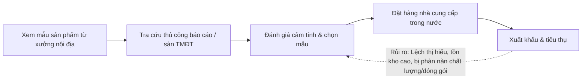
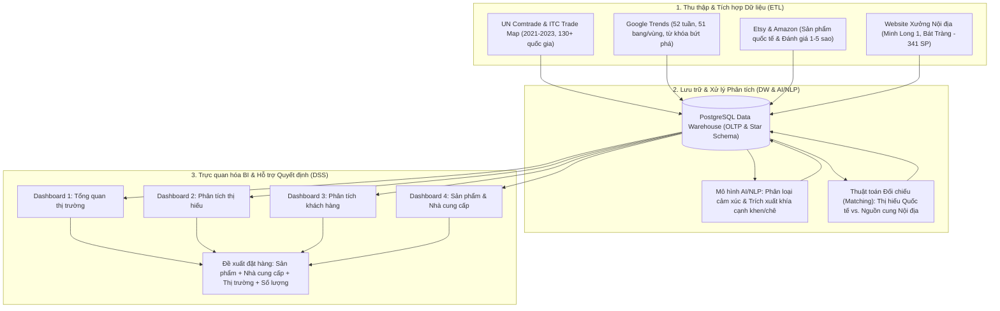

# TÀI LIỆU PHÂN TÍCH YÊU CẦU NGHIỆP VỤ (BUSINESS REQUIREMENTS DOCUMENT)

- **Đề tài:** Xây dựng hệ thống Business Intelligence phân tích thị hiếu tiêu dùng quốc tế và hỗ trợ ra quyết định đặt hàng xuất khẩu gốm sứ Việt Nam
- **Học phần:** Hệ thống Kinh doanh Thông minh (HTKDTM)
- **Nhóm thực hiện:** Nhóm 06 – Lớp 65HTTT
- **Người phụ trách:** Trần Mai Ngọc Anh (Nhóm trưởng – Phân tích nghiệp vụ & Thiết kế CSDL)

---

## 1. Giới Thiệu Và Bối Cảnh Nghiệp Vụ

### 1.1. Mô hình hoạt động của doanh nghiệp
Doanh nghiệp mục tiêu trong dự án là **doanh nghiệp thương mại xuất khẩu gốm sứ Việt Nam** (B2B/B2C Cross-border Trading). Đặc thù vận hành của doanh nghiệp:
- **Không trực tiếp sở hữu nhà máy sản xuất**, mà đóng vai trò cầu nối thương mại giữa các cơ sở sản xuất gốm sứ trong nước (như Gốm sứ Minh Long 1, Làng gốm Bát Tràng,...) và các thị trường nhập khẩu quốc tế (Hoa Kỳ, Nhật Bản, Đức, Pháp, Ấn Độ,...).
- Hoạt động cốt lõi là **nghiên cứu nhu cầu thị trường quốc tế $\rightarrow$ lựa chọn danh mục sản phẩm phù hợp thị hiếu $\rightarrow$ lựa chọn nhà cung cấp trong nước tối ưu về giá, công suất và thời gian giao hàng $\rightarrow$ đặt hàng thu mua và xuất khẩu**.

### 1.2. Bài toán nghiệp vụ cần giải quyết
Sự khác biệt lớn về văn hóa và lối sống dẫn đến thị hiếu tiêu dùng gốm sứ tại mỗi quốc gia rất khác nhau (ví dụ: người tiêu dùng Nhật Bản ưa chuộng bộ ấm chén, bát đĩa phong cách tối giản, màu tự nhiên; người tiêu dùng Mỹ ưa chuộng đồ trang trí và gia dụng màu sắc đa dạng, hiện đại, an toàn với máy rửa bát; thị trường Đức chú trọng tính ứng dụng và thiết kế đơn giản).

Hiện tại, doanh nghiệp đang gặp **5 điểm nghẽn nghiệp vụ chính**:
1. **Thiếu thông tin định lượng về thị hiếu khách hàng:** Chưa xác định rõ từng quốc gia ưa chuộng dòng sản phẩm, màu sắc, hình dạng, chất liệu men, phong cách thiết kế và phân khúc giá nào.
2. **Khó đánh giá và so sánh tiềm năng thị trường:** Dữ liệu kim ngạch xuất nhập khẩu, khối lượng giao thương và xu hướng tìm kiếm nằm rời rạc, khó nhận diện thị trường nào đang tăng trưởng hay bão hòa.
3. **Chưa khai thác được phản hồi thực tế của người tiêu dùng:** Hàng nghìn đánh giá trên các sàn thương mại điện tử quốc tế (Amazon, Etsy) chưa được tổng hợp để biết khách hàng khen ngợi hay phàn nàn về đặc tính nào (độ bền lớp men, khả năng chịu nhiệt, quy cách đóng gói chống vỡ,...).
4. **Rủi ro đặt hàng cảm tính:** Quyết định chọn mẫu và số lượng đặt hàng phụ thuộc nhiều vào kinh nghiệm chủ quan, dễ dẫn đến tồn kho chậm luân chuyển hoặc bỏ lỡ xu hướng mới.
5. **Thiếu cơ chế đối chiếu tự động với nguồn cung nội địa:** Chưa có hệ thống kết nối trực tiếp nhu cầu thị trường quốc tế với danh mục sản phẩm, giá niêm yết, năng lực sản xuất (sản phẩm/tháng) và thời gian giao hàng của các cơ sở sản xuất trong nước.

---

## 2. Phân Tích Quy Trình Nghiệp Vụ (As-Is vs. To-Be)

### 2.1. Quy trình nghiệp vụ hiện tại (As-Is) và hạn chế

### 2.2. Quy trình nghiệp vụ mục tiêu khi áp dụng Hệ thống BI & AI (To-Be)

---

## 3. Xác Định Tác Nhân (Actors) Và Nhu Cầu Thông Tin

| STT | Tác nhân (Actor) | Vai trò trong doanh nghiệp | Nhu cầu thông tin & Ra quyết định trên hệ thống |
| :-: | :--- | :--- | :--- |
| 1 | **Ban Giám đốc / Quản lý Kinh doanh** | Hoạch định chiến lược thị trường và phê duyệt đơn đặt hàng xuất khẩu | • Theo dõi quy mô kim ngạch (USD), khối lượng (kg), tốc độ tăng trưởng và thị phần của hơn 130 quốc gia. • Xem tổng hợp xu hướng thị trường và phê duyệt kế hoạch đặt hàng xuất khẩu theo gợi ý của hệ thống. |
| 2 | **Chuyên viên Thu mua & Phát triển Sản phẩm (Sourcing / Merchandiser)** | Lựa chọn mẫu mã sản phẩm và làm việc với các cơ sở sản xuất gốm sứ trong nước | • Nắm bắt chi tiết thuộc tính đang thịnh hành tại từng thị trường (màu sắc, hình dạng, chất liệu, phong cách, tầm giá). • Xem các điểm khách hàng quốc tế hay phàn nàn (vỡ khi vận chuyển, lỗi men, không dùng được máy rửa bát) để đặt tiêu chuẩn kỹ thuật với xưởng. • So sánh danh mục 341 sản phẩm nội địa (Minh Long 1, Bát Tràng) về giá nhập, năng lực cung ứng (10.000 – 500.000 SP/tháng) và cam kết giao hàng. |
| 3 | **Chuyên viên Phân tích Dữ liệu / Quản trị hệ thống (Data Analyst / Admin)** | Vận hành quy trình dữ liệu, cập nhật nguồn cung và mô hình phân tích | • Quản lý quy trình nạp dữ liệu (ETL) từ 5 nguồn vào PostgreSQL. • Vận hành mô hình AI/NLP phân tích đánh giá khách hàng. • Cập nhật thông tin nhà cung cấp, danh mục sản phẩm mới và kiểm soát chất lượng dữ liệu. |

---

## 4. Đặc Tả Yêu Cầu Chức Năng Theo Phân Hệ (Functional Requirements)

### 4.1. Phân hệ 1: Thu thập, chuẩn hóa và tích hợp dữ liệu
Hệ thống phải tích hợp và quản lý tập trung **5 nhóm dữ liệu đầu vào** với phạm vi cụ thể:

| Mã YC | Nhóm dữ liệu | Nguồn khai thác | Yêu cầu dữ liệu chi tiết cần đáp ứng |
| :---: | :--- | :--- | :--- |
| **FR-1.1** | Dữ liệu thương mại quốc tế | UN Comtrade & ITC Trade Map | • Bao phủ giao thương gốm sứ giữa Việt Nam với thế giới và **>130 quốc gia/vùng lãnh thổ** (Mỹ, Nhật, Đức, Trung Quốc, Ấn Độ,...) giai đoạn **2021 – 2023**. • Quản lý đầy đủ **14 chỉ tiêu kinh tế**: Kim ngạch mậu dịch (USD), trị giá FOB, trị giá CIF, khối lượng tịnh (kg), đơn vị số lượng, luồng xuất khẩu / nhập khẩu, thị phần và tăng trưởng YoY. |
| **FR-1.2** | Dữ liệu xu hướng tìm kiếm | Google Trends | • Chuỗi thời gian liên tục **52 tuần** (12 tháng gần nhất) cho **4 nhóm sản phẩm gốm sứ chủ lực**. • Phân bố mức độ quan tâm chi tiết theo khu vực địa lý (**51 bang/vùng lãnh thổ**). • Danh mục từ khóa thịnh hành và mức độ tăng trưởng bứt phá (từ +140% đến +5.300%). |
| **FR-1.3** | Dữ liệu sản phẩm quốc tế | Sàn TMĐT quốc tế (Etsy, Amazon) & Chuỗi bán lẻ mở | • Thông tin sản phẩm gốm sứ quốc tế (bộ bát đĩa, ly tách, bình hoa, đồ trang trí): Tên sản phẩm, danh mục, giá bán (USD), hình ảnh, URL gốc. • Các thuộc tính chi tiết: Màu sắc, hình dạng, chất liệu men nung, phong cách thiết kế, đặc tính kỹ thuật (chịu nhiệt, an toàn máy rửa bát/lò vi sóng). |
| **FR-1.4** | Dữ liệu đánh giá khách hàng | Etsy, Amazon | • Lượt nhận xét chi tiết của người mua quốc tế: Điểm đánh giá (**1 – 5 sao**), thời gian đánh giá, nội dung văn bản nhận xét, sản phẩm liên kết. |
| **FR-1.5** | Dữ liệu nhà cung cấp & sản phẩm nội địa | Website cơ sở sản xuất Việt Nam (Minh Long 1, Bát Tràng) | • Hồ sơ nhà cung cấp: Tên xưởng, địa chỉ, hotline, website, năng lực sản xuất (**10.000 – >500.000 sản phẩm/tháng**), cam kết thời gian giao hàng (Lead time). • Danh mục **341 sản phẩm nội địa** (Minh Long 1: 297 SP; Bát Tràng: 44 SP) thuộc **4 dòng chính**: Bộ ấm chén, Ly cốc sứ, Bát đĩa bàn ăn, Lọ hoa mỹ nghệ; kèm giá niêm yết (VND/USD quy đổi) và thuộc tính sản phẩm. |

### 4.2. Phân hệ 2: Phân tích thị hiếu và thị trường bằng AI/NLP
- **FR-2.1 – Phân tích quy mô và tiềm năng thị trường:** Tính toán quy mô nhập khẩu, tốc độ tăng trưởng kim ngạch hàng năm (YoY / CAGR), tỷ trọng thị phần của từng quốc gia để xếp hạng các thị trường tiềm năng.
- **FR-2.2 – Phân tích xu hướng tìm kiếm theo thời gian & vùng địa lý:** Thống kê biến động chỉ số quan tâm (Interest Score 0–100) qua 52 tuần, nhận diện tính mùa vụ và các từ khóa phong cách gốm sứ đang bứt phá.
- **FR-2.3 – Phân tích thị hiếu theo thuộc tính sản phẩm:** Thống kê tần suất, tỷ trọng và mức giá trung bình theo **5 nhóm thuộc tính cốt lõi**:
  1. *Loại/Dòng sản phẩm* (Bộ ấm chén, Ly cốc sứ, Bát đĩa bàn ăn, Lọ hoa/Đồ trang trí).
  2. *Màu sắc* (Trắng, xanh, nâu, màu tự nhiên, đa sắc,...).
  3. *Hình dạng* (Tròn, vuông, oval, hình dáng nghệ thuật,...).
  4. *Chất liệu* (Gốm đất nung, sứ cao cấp, stoneware, men rạn/men ngọc,...).
  5. *Phong cách & Tính năng* (Truyền thống, tối giản, hiện đại, thủ công; chịu nhiệt, an toàn máy rửa bát).
- **FR-2.4 – Phân loại cảm xúc đánh giá bằng AI/NLP (Sentiment Analysis):** Tự động phân loại từng nhận xét của khách hàng quốc tế vào **3 trạng thái cảm xúc**: `Tích cực (Positive)`, `Trung lập (Neutral)`, `Tiêu cực (Negative)` kết hợp đối chiếu với thang điểm 1–5 sao.
- **FR-2.5 – Trích xuất khía cạnh sản phẩm được khen/chê (Aspect Extraction):** Nhận diện và thống kê các chủ đề/đặc điểm cụ thể trong bình luận khách hàng như: *độ bền lớp men, tính thẩm mỹ/màu sắc, khả năng chịu nhiệt/máy rửa bát, quy cách đóng gói bao bì chống vỡ, giá trị so với giá tiền*.

### 4.3. Phân hệ 3: Quản lý dữ liệu và kết nối nhà cung cấp nội địa
- **FR-3.1 – Quản lý danh mục nhà cung cấp và sản phẩm trong nước:** Cho phép tra cứu, lọc, thêm/sửa thông tin cơ sở sản xuất và danh mục 341+ sản phẩm gốm sứ nội địa cùng đầy đủ thuộc tính kỹ thuật, giá nhập, công suất và thời gian giao hàng.
- **FR-3.2 – Đối chiếu cung – cầu (Market-to-Supplier Matching):** Xây dựng cơ chế so khớp giữa **Hồ sơ thị hiếu của thị trường mục tiêu** (Dòng sản phẩm + Màu sắc + Hình dạng + Chất liệu + Phong cách + Khoảng giá kỳ vọng) với **Danh mục sản phẩm của nhà cung cấp nội địa**.
- **FR-3.3 – Đánh giá và xếp hạng nhà cung cấp:** Chấm điểm mức độ phù hợp của sản phẩm & nhà cung cấp dựa trên:
  - Độ khớp thuộc tính sản phẩm với thị hiếu thị trường mục tiêu.
  - Biên lợi nhuận kỳ vọng (Chênh lệch giữa giá bán trung bình tại thị trường quốc tế và giá nhập từ xưởng nội địa).
  - Năng lực cung ứng (sản phẩm/tháng) và thời gian giao hàng (Lead time).

### 4.4. Phân hệ 4: Hệ thống Dashboard BI và Hỗ trợ ra quyết định đặt hàng
Hệ thống phải cung cấp giao diện Website tích hợp **4 Dashboard BI chuyên sâu** và **1 Màn hình Đề xuất đặt hàng**:

| Thành phần | Mục tiêu phân tích | Nội dung biểu đồ & chỉ số hiển thị chính | Bộ lọc tương tác (Slicers/Filters) |
| :--- | :--- | :--- | :--- |
| **Dashboard 1: Tổng quan thị trường** | Đánh giá quy mô, vị thế và tốc độ tăng trưởng thương mại gốm sứ toàn cầu | • Bản đồ/Biểu đồ Top quốc gia nhập khẩu gốm sứ lớn nhất (USD & kg). • Biểu đồ xu hướng kim ngạch và tốc độ tăng trưởng giai đoạn 2021–2023. • Bảng so sánh 14 chỉ tiêu thương mại (FOB, CIF, thị phần, khối lượng tịnh). • Biểu đồ đường xu hướng tìm kiếm Google Trends 52 tuần và bản đồ 51 bang/vùng. | Năm (2021–2023), Quốc gia/Khu vực, Luồng thương mại (Xuất/Nhập), Nhóm sản phẩm |
| **Dashboard 2: Phân tích thị hiếu** | Giải mã khách hàng tại từng quốc gia ưa chuộng thuộc tính sản phẩm nào | • Biểu đồ tỷ trọng 4 dòng sản phẩm chủ lực theo quốc gia. • Biểu đồ phân bố 5 thuộc tính: Màu sắc, Hình dạng, Chất liệu, Phong cách, Tính năng chịu nhiệt/máy rửa bát. • Biểu đồ phân khúc giá bán (USD) phổ biến theo từng dòng sản phẩm. • Bảng xếp hạng các từ khóa xu hướng bứt phá (+140% đến +5.300%). | Quốc gia mục tiêu, Dòng sản phẩm, Màu sắc, Chất liệu, Phong cách, Khoảng giá |
| **Dashboard 3: Phân tích khách hàng (AI/NLP)** | Đo lường sự hài lòng và các yếu tố được khen/chê từ người mua thực tế | • KPI điểm đánh giá trung bình (Average Rating 1–5 sao) và tổng lượt review. • Biểu đồ tròn/cột chồng tỷ lệ 3 trạng thái cảm xúc: Tích cực, Trung lập, Tiêu cực. • Biểu đồ tần suất các khía cạnh được khen ngợi vs. bị phàn nàn (độ bền men, bao bì đóng gói, kích thước, chịu nhiệt...). • Danh sách chi tiết các bình luận tiêu biểu theo từng khía cạnh. | Sàn TMĐT (Etsy/Amazon), Dòng sản phẩm, Nhãn cảm xúc, Số sao (1–5), Khía cạnh (Aspect) |
| **Dashboard 4: Sản phẩm & Nhà cung cấp** | Đánh giá năng lực nguồn cung nội địa và độ tương thích với thị trường | • Thống kê cơ cấu 341 sản phẩm nội địa theo nhà cung cấp (Minh Long 1: 297 SP, Bát Tràng: 44 SP) và theo 4 dòng sản phẩm. • Biểu đồ so sánh mặt bằng giá nhập, năng lực sản xuất (10.000 – 500.000 SP/tháng) và thời gian giao hàng. • Ma trận đối chiếu độ khớp (Matching Score) giữa sản phẩm nội địa và thị hiếu quốc tế. | Nhà cung cấp, Dòng sản phẩm, Khoảng giá nhập, Công suất tối thiểu, Thời gian giao hàng |
| **Màn hình: Đề xuất đặt hàng (DSS)** | Hỗ trợ nhà quản lý ra quyết định đặt hàng xuất khẩu dựa trên dữ liệu | • Khi chọn **Thị trường mục tiêu** (VD: Mỹ, Nhật, Đức) và **Ngân sách/Kế hoạch**: Hệ thống tự động đề xuất:   1. Nhóm sản phẩm & mẫu sản phẩm nội địa phù hợp nhất.   2. Nhà cung cấp khuyến nghị (Minh Long 1 / Bát Tràng) kèm giá nhập & thời gian giao.   3. Số lượng đặt hàng tham khảo (dựa trên nhu cầu thị trường, điểm xu hướng và năng lực cung ứng).   4. Lưu ý kỹ thuật khi đặt hàng (dựa trên phân tích phàn nàn khách hàng, VD: cần gia cố bao bì chống sốc, đảm bảo chuẩn an toàn máy rửa bát). | Thị trường mục tiêu, Dòng sản phẩm ưu tiên, Ngân sách dự kiến, Thời hạn giao hàng mong muốn |

---

## 5. Hệ Thống Chỉ Số Phân Tích (KPIs/Measures) Và Chiều Phân Tích (Dimensions)

Phần này làm cơ sở trực tiếp để thiết kế **Mô hình CSDL Quan hệ (ERD)** và **Mô hình Kho dữ liệu (Star Schema)** ở bước tiếp theo.

### 5.1. Danh mục các Chiều phân tích (Analytical Dimensions)
1. **Chiều Thời gian (`Dim_Time`):** Năm (2021–2023+), Quý, Tháng, Tuần trong năm (1–52 tuần của Google Trends), Ngày cụ thể.
2. **Chiều Địa lý / Thị trường (`Dim_Location` / `Dim_Market`):** Quốc gia (>130 nước, mã ISO3), Khu vực/Châu lục, Bang/Vùng lãnh thổ (51 bang/vùng từ Google Trends).
3. **Chiều Sản phẩm & Thuộc tính (`Dim_Product` & `Dim_Product_Attribute`):**
   - Phân biệt nguồn sản phẩm: Sản phẩm quốc tế (Etsy/Amazon) và Sản phẩm nội địa (Minh Long 1/Bát Tràng).
   - 4 dòng sản phẩm chính: Bộ ấm chén, Ly cốc sứ, Bát đĩa bàn ăn, Lọ hoa mỹ nghệ / Đồ trang trí.
   - 5 nhóm thuộc tính chuẩn hóa: Màu sắc (`color`), Hình dạng (`shape`), Chất liệu (`material`), Phong cách (`style`), Đặc tính kỹ thuật (`feature`: chịu nhiệt, an toàn máy rửa bát) và Phân khúc giá (`price_segment`).
4. **Chiều Nhà cung cấp nội địa (`Dim_Supplier`):** Định danh cơ sở sản xuất (Minh Long 1, Bát Tràng), địa chỉ, liên hệ, quy mô công suất tối đa (SP/tháng), thời gian giao hàng tiêu chuẩn (ngày).
5. **Chiều Đánh giá & Cảm xúc khách hàng (`Dim_Sentiment` / `Dim_Aspect`):** Nhãn cảm xúc (Positive, Neutral, Negative), Nhóm khía cạnh sản phẩm (Độ bền men, Bao bì đóng gói, Thiết kế/Màu sắc, Công năng chịu nhiệt, Giá cả).

### 5.2. Danh mục các Chỉ số đo lường (Measures / KPIs)

| Nhóm chỉ số | Tên chỉ số (Measure / KPI) | Công thức / Ý nghĩa nghiệp vụ | Đơn vị tính |
| :--- | :--- | :--- | :---: |
| **1. Thương mại quốc tế** | Kim ngạch thương mại (`trade_value_usd`) | Tổng giá trị xuất/nhập khẩu gốm sứ theo quốc gia và năm | USD |
| | Trị giá FOB / CIF (`fob_value`, `cif_value`) | Giá trị hàng hóa tại cảng xuất (FOB) và cảng nhập (CIF) | USD |
| | Khối lượng tịnh (`net_weight_kg`) | Tổng trọng lượng hàng gốm sứ giao thương | Kg |
| | Tốc độ tăng trưởng kim ngạch (`yoy_growth_rate`) | $\frac{\text{Kim ngạch năm } t - \text{Kim ngạch năm } t-1}{\text{Kim ngạch năm } t-1} \times 100\%$ | % |
| | Thị phần nhập khẩu (`market_share_pct`) | Tỷ trọng kim ngạch của quốc gia trên tổng kim ngạch toàn cầu | % |
| **2. Xu hướng & Thị hiếu** | Chỉ số quan tâm tìm kiếm (`search_interest_score`) | Mức độ quan tâm trên Google Trends theo tuần/vùng | Điểm (0–100) |
| | Tốc độ bứt phá từ khóa (`keyword_breakout_pct`) | Mức tăng trưởng tìm kiếm của từ khóa thịnh hành (+140% đến +5.300%) | % |
| | Giá bán quốc tế trung bình (`avg_market_price_usd`) | Trung bình giá niêm yết của nhóm sản phẩm/thuộc tính trên sàn quốc tế | USD |
| | Tỷ trọng sản phẩm theo thuộc tính (`attribute_share_pct`) | % số lượng sản phẩm mang thuộc tính (màu sắc/chất liệu/phong cách) tại thị trường | % |
| **3. Khách hàng (AI/NLP)** | Điểm đánh giá trung bình (`avg_rating_score`) | Trung bình cộng điểm sao của sản phẩm / nhóm thuộc tính | Sao (1.0–5.0) |
| | Tỷ lệ cảm xúc tích cực (`positive_sentiment_rate`) | $\frac{\text{Số đánh giá Tích cực}}{\text{Tổng số đánh giá}} \times 100\%$ | % |
| | Tỷ lệ phàn nàn theo khía cạnh (`aspect_complaint_rate`) | Tần suất xuất hiện nhận xét tiêu cực ở từng khía cạnh (bao bì, men, chịu nhiệt...) | % / Số lượt |
| **4. Nguồn cung & Đề xuất đặt hàng** | Giá nhập nội địa (`domestic_unit_cost`) | Giá thu mua từ nhà cung cấp trong nước (quy đổi VND / USD) | VND & USD |
| | Năng lực cung ứng (`monthly_capacity`) | Sản lượng cung ứng tối đa của xưởng trong 1 tháng | SP / tháng |
| | Thời gian giao hàng (`lead_time_days`) | Thời gian từ khi đặt hàng đến khi xưởng giao hàng | Ngày |
| | Điểm phù hợp thị trường (`matching_score`) | Điểm tổng hợp (0–100) đo độ khớp giữa sản phẩm nội địa với thị hiếu thị trường, biên giá và công suất nhà cung cấp | Điểm (0–100) |
| | Số lượng đặt hàng đề xuất (`recommended_order_qty`) | Số lượng đặt hàng tham khảo dựa trên điểm cầu thị trường, công suất xưởng và quy mô đơn hàng tiêu chuẩn | Sản phẩm |

---

## 6. Yêu Cầu Phi Chức Năng Và Tiêu Chí Nghiệm Thu

### 6.1. Yêu cầu phi chức năng (Non-Functional Requirements)
1. **Tính toàn vẹn và chuẩn hóa dữ liệu:** Dữ liệu từ 5 nguồn khác nhau về ngôn ngữ (Tiếng Anh/Tiếng Việt), tiền tệ (USD/VND) và đơn vị đo lường phải được chuẩn hóa đồng nhất trước khi nạp vào PostgreSQL.
2. **Kiến trúc dữ liệu chuẩn BI:** Cơ sở dữ liệu PostgreSQL phải hỗ trợ tốt cả nhu cầu quản lý tác vụ trên Website (OLTP - ERD) và nhu cầu truy vấn tổng hợp nhanh cho Dashboard BI (OLAP - Star Schema).
3. **Tính khả dụng và trực quan:** Các Dashboard hiển thị rõ ràng, tốc độ phản hồi khi thay đổi bộ lọc (Quốc gia, Thời gian, Dòng sản phẩm) dưới 3 giây.
4. **Tính giải thích được của hệ thống hỗ trợ quyết định (Explainable DSS):** Mọi đề xuất đặt hàng đều phải kèm theo lý giải rõ ràng dựa trên số liệu (ví dụ: *Đề xuất sản phẩm X của Minh Long 1 cho thị trường Mỹ vì khớp phong cách hiện đại, an toàn máy rửa bát, nhu cầu tìm kiếm tăng +250% và biên giá chênh lệch tốt*).

### 6.2. Đối chiếu với Tiêu chí đánh giá của Project
- **Số nhóm nguồn dữ liệu tích hợp:** Đạt **5 nhóm nguồn** (UN Comtrade, ITC Trade Map, Google Trends, Etsy/Amazon, Website Minh Long 1 & Bát Tràng) $\rightarrow$ *Vượt mục tiêu tối thiểu (3 nhóm)*.
- **Số thị trường phân tích:** Bao phủ **>130 quốc gia** trong dữ liệu thương mại và đi sâu phân tích các thị trường trọng điểm (**Mỹ, Nhật, Đức, Pháp,...**) $\rightarrow$ *Vượt mục tiêu tối thiểu (3 thị trường)*.
- **Số thuộc tính sản phẩm phân tích:** Đạt **6 thuộc tính** (Dòng sản phẩm, Màu sắc, Hình dạng, Chất liệu, Phong cách, Đặc tính kỹ thuật/Mức giá) $\rightarrow$ *Vượt mục tiêu tối thiểu (5 thuộc tính)*.
- **Số lượng Dashboard BI:** **4 Dashboard chuyên biệt + 1 Màn hình đề xuất đặt hàng** $\rightarrow$ *Đạt đầy đủ mục tiêu đề cương*.
