# TÀI LIỆU THU THẬP VÀ XỬ LÝ DỮ LIỆU

- **Đề tài:** Xây dựng hệ thống Business Intelligence phân tích thị hiếu tiêu dùng quốc tế và hỗ trợ ra quyết định đặt hàng xuất khẩu gốm sứ Việt Nam
- **Học phần:** Hệ thống Kinh doanh Thông minh (HTKDTM)
- **Nhóm thực hiện:** Nhóm 06 – Lớp 65HTTT
- **Phạm vi:** Phân hệ 1 – Thu thập, chuẩn hóa và tích hợp dữ liệu (Data Collection & ETL)
- **Tài liệu nghiệp vụ đối chiếu:** [PHÂN TÍCH YÊU CẦU NGHIỆP VỤ.md](./PHÂN%20TÍCH%20YÊU%20CẦU%20NGHIỆP%20VỤ.md)

## MỤC LỤC

1. [Tổng quan và phạm vi thu thập dữ liệu](#1-tổng-quan-và-phạm-vi-thu-thập-dữ-liệu)
2. [Danh sách và mô tả các nguồn dữ liệu](#2-danh-sách-và-mô-tả-các-nguồn-dữ-liệu)
3. [Từ điển dữ liệu theo nguồn](#3-từ-điển-dữ-liệu-theo-nguồn)
4. [Quy trình ETL tổng thể](#4-quy-trình-etl-tổng-thể)
5. [Quy tắc chuẩn hóa và kiểm tra chất lượng](#5-quy-tắc-chuẩn-hóa-và-kiểm-tra-chất-lượng)
6. [Phát hiện trùng lặp và xử lý dữ liệu lỗi](#6-phát-hiện-trùng-lặp-và-xử-lý-dữ-liệu-lỗi)
7. [Cấu trúc lưu trữ dữ liệu](#7-cấu-trúc-lưu-trữ-dữ-liệu)
8. [Kết quả thực nghiệm và thống kê theo nguồn](#8-kết-quả-thực-nghiệm-và-thống-kê-theo-nguồn)
9. [Hạn chế và hướng hoàn thiện](#9-hạn-chế-và-hướng-hoàn-thiện)
10. [Tổng hợp tiến độ toàn bộ quy trình](#10-tổng-hợp-tiến-độ-toàn-bộ-quy-trình)
11. [Đối chiếu yêu cầu FR-1.1 đến FR-1.5](#11-đối-chiếu-yêu-cầu-fr-11-đến-fr-15)

---

## 1. TỔNG QUAN VÀ PHẠM VI THU THẬP DỮ LIỆU

### 1.1. Mục đích

Tài liệu mô tả nguồn và trường dữ liệu, cách thu thập, các bước Extract – Transform – Load (ETL), quy tắc chất lượng, cơ chế deduplication/quarantine và kết quả kiểm tra các tập dữ liệu hiện có. Nội dung phân biệt dữ liệu thực tế với schema được hỗ trợ bởi code hoặc fixture.

Tên trường sau chuẩn hóa trong tài liệu là trường của các cấu trúc ETL trung gian (`Parsed*Record`/`Normalized*Record`), không mặc nhiên là tên cột database.

### 1.2. Phạm vi

Phạm vi quy trình theo yêu cầu đề tài gồm dữ liệu thương mại quốc tế (UN Comtrade và ITC Trade Map), Google Trends, listing và review Etsy/Amazon, cùng hồ sơ nhà cung cấp và catalog nội địa (Minh Long 1, Bát Tràng). Các công đoạn downstream gồm lưu trữ, chuẩn hóa, kiểm tra, deduplication, quarantine/recovery, processed storage, mapping và nạp vào cơ sở dữ liệu. Đây là phạm vi cần thực hiện; việc liệt kê một công đoạn không có nghĩa công đoạn đó đã triển khai.

Trong repository hiện tại, `pipeline.py` chỉ xử lý raw collection đã có và không gọi collector hoặc truy cập Internet. Pipeline hỗ trợ UN Comtrade, Google Trends và catalog nội địa; không có nhánh xử lý raw ITC, marketplace listing hoặc review. Kết quả processed hiện được thiết kế là JSONL cục bộ; không tìm thấy database loader hoặc kết nối PostgreSQL trong ETL. Dashboard, AI/NLP, matching và đề xuất đặt hàng thuộc các phân hệ khác theo tài liệu nghiệp vụ, không được xem là kết quả ETL đã triển khai.

Tài liệu phân biệt quy trình mục tiêu, giải pháp thiết kế, code hiện có, dữ liệu quan sát được và phần còn phụ thuộc. Việc có collector, parser hoặc fixture không đồng nghĩa nguồn đã được thu thập thực tế. Không thay đổi raw, database schema, ERD, DDL hoặc tài liệu yêu cầu nghiệp vụ trong lần rà soát này.

### 1.3. Quy ước trạng thái tiến độ

| Trạng thái | Cách sử dụng |
|---|---|
| **Đã hoàn thành** | Công đoạn đã triển khai và có bằng chứng kiểm thử hoặc dữ liệu xác nhận đúng phạm vi công đoạn |
| **Đang thực hiện** | Đã có một phần triển khai hoặc dữ liệu, nhưng còn thiếu yêu cầu hoặc chưa vận hành end-to-end |
| **Chưa thực hiện** | Chưa có triển khai thực tế cho công đoạn được nêu |
| **Chờ phụ thuộc** | Cần dữ liệu nguồn, quyền truy cập, phê duyệt, seed/mapping hoặc thành phần từ nhóm/phân hệ khác |
| **Cần kiểm chứng** | Có code hoặc dấu vết triển khai nhưng chưa đủ bằng chứng để xác nhận hành vi/kết quả thực tế |

Trạng thái được gắn cho đúng phạm vi trong từng dòng. Ví dụ, parser có thể đã có code trong khi thu thập listing thực tế chưa thực hiện; kết quả audit hợp lệ không đồng nghĩa đã ghi processed hoặc nạp database.

### 1.4. Quy ước đọc từ điển dữ liệu

- **Quan sát trong raw:** tên và kiểu trường thấy trực tiếp trong payload/CSV hiện có.
- **Đầu vào theo code:** tên trường mà parser/adapter hiện hỗ trợ; nếu nguồn chưa có raw thì đây không phải bằng chứng về phản hồi API thực tế.
- **ETL tạo/ánh xạ:** tên trường hoặc giá trị do importer, collector, parser hay normalizer tạo ra.
- `Bắt buộc` phân biệt yêu cầu parser với yêu cầu validator. Một trường có thể optional ở parser nhưng required khi validation.
- `NormalizedField[T]` là cấu trúc ETL giữ `raw`, `value`, `status`, `note`; `T` là kiểu của `value`.

## 2. DANH SÁCH VÀ MÔ TẢ CÁC NGUỒN DỮ LIỆU

| Nguồn | Yêu cầu dữ liệu | Phương thức thu thập theo thiết kế/code | Module liên quan | Dữ liệu thực tế hiện có | Tiến độ | Vấn đề còn lại |
|---|---|---|---|---|---|---|
| UN Comtrade | Giao thương Việt Nam với thế giới giai đoạn 2021–2023; reporter/partner, HS, luồng, giá trị và các chỉ tiêu FR-1.1 | Preview API; collector tạo request theo năm, HS và flow rồi lưu JSON response | `trade_collector.py`, `http_client.py`, `trade_parser.py`, `normalizer.py` | 18 raw collections; 574/574 record audit hợp lệ; reporter `704`, 78 giá trị partner code chưa xác minh là 78 quốc gia | **Đang thực hiện** | Chưa chứng minh >130 quốc gia; FOB/CIF/qty không được chuyển đầy đủ vào DTO; quantity unit và measures dẫn xuất còn thiếu; response Preview có thể bị cắt |
| ITC Trade Map | Bổ sung dữ liệu thương mại và độ phủ theo FR-1.1 | File export được cung cấp; parser CSV và adapter file | `trade_collector.py` (`ITCTradeMapFileAdapter`), `trade_parser.py` (`ITCTradeMapParser`) | Không có ITC raw hoặc file export hiện tại | **Chờ phụ thuộc** | Cần quyền/file export; xác nhận header, đơn vị `Value (USD thousands)` và đối chiếu với Comtrade trước khi sử dụng |
| Google Trends | 4 nhóm sản phẩm, 52 tuần liên tục trong 12 tháng gần nhất, 51 bang/vùng, Interest Over Time/Region và Related Queries/Topics | Xuất CSV thủ công từ giao diện Google Trends, sau đó kiểm tra/import vào raw | `google_trends_csv_importer.py`, `google_trends_collector.py`, `trends_parser.py`, `normalizer.py` | Không có `data/incoming/google_trends/` hoặc raw Trends collection hiện tại | **Chờ phụ thuộc** | Importer G1 đang cấu hình 5 keyword, 6 geo và Past 5 years; chưa có bộ export để xác nhận cadence tuần, 51 vùng hoặc 4 nhóm |
| Etsy – listing | Tên, danh mục, USD, ảnh, URL và thuộc tính sản phẩm theo FR-1.3 | Thiết kế dự kiến dùng API/response adapter; hiện có parser/adapter nhưng không có luồng thu thập listing trong pipeline | `marketplace_parser.py` (`EtsyListingParser`), `product_response.py` (`EtsyListingResponseAdapter`) | Không có raw listing; fixture chỉ là dữ liệu kiểm thử | **Chưa thực hiện** | Cần xác nhận quyền truy cập/chính sách API và triển khai collector, thuộc tính ảnh/màu/hình/chất liệu/phong cách/tính năng |
| Amazon – listing | Trường listing và thuộc tính sản phẩm quốc tế theo FR-1.3 | Dự kiến tiếp nhận response Creators API; hiện có parser/adapter | `marketplace_parser.py` (`AmazonCreatorsParser`), `product_response.py` (`AmazonCreatorsResponseAdapter`) | Không có raw listing; fixture chỉ là dữ liệu kiểm thử | **Chưa thực hiện** | Chưa có collector HTTP listing và chưa xác nhận eligibility/quyền truy cập, dữ liệu USD, ảnh và thuộc tính chi tiết |
| Etsy – review | Rating 1–5, ngày, nội dung và sản phẩm liên kết theo FR-1.4 | Collector HTTP có phân trang; cần API key và source `ACTIVE` | `review_collector.py`, `review_parser.py`, `quality_validator.py` | Không có raw review | **Chờ phụ thuộc** | Registry hiện `PLANNED`, collector yêu cầu source `ACTIVE`; cần quyền/API key và xác nhận chính sách truy cập/lưu trữ |
| Amazon – review | Rating, thời gian, nội dung và listing liên kết theo FR-1.4 | Chưa tìm thấy collector/parser review trong ETL hiện tại | Chưa có module tương ứng | Không có raw review | **Chưa thực hiện** | Cần xác nhận nguồn/API được phép và triển khai collector/parser sau khi thống nhất schema |
| Minh Long 1 | Hồ sơ nhà cung cấp và danh mục theo FR-1.5 (đặc tả yêu cầu 297 sản phẩm) | Manifest hiện ghi URL catalog và 9 trang; generic HTTP collector yêu cầu source type `API` | `domestic_supplier_collector.py`, `domestic_parser.py`, `normalizer.py` | 1 raw collection, 450 product record; audit 450/450 hợp lệ | **Cần kiểm chứng** | Registry ghi `FILE_DATASET` không có `base_url`, không khớp điều kiện collector và URL trong manifest; chưa xác minh nguồn gốc/độ mới của raw hoặc phân loại đủ 297 sản phẩm |
| Bát Tràng | Hồ sơ nhà cung cấp và 44 sản phẩm theo FR-1.5; giá và thuộc tính cần có nguồn chứng minh | Collector WooCommerce Store API có logic phân trang, lưu response body Base64 trước mapping và tạo D9 để parse | `bat_trang_collector.py`, `http_client.py`, `domestic_parser.py` | Không có Bát Tràng raw collection hiện tại | **Cần kiểm chứng** | Registry ghi `FILE_DATASET` trong khi collector gọi HTTP API; cần xác nhận vận hành và thu thập raw thật. Không tự tạo giá khi nguồn thiếu |
| Thế Giới Gốm | Nguồn catalog bổ sung; không thay thế nhà sản xuất Bát Tràng trong FR-1.5 | Manifest ghi endpoint WooCommerce và 5 trang; collector HTTP nội địa tổng quát có trong code | `domestic_supplier_collector.py`, `domestic_parser.py` | 1 raw collection, 500 product record; audit 500/500 hợp lệ | **Đang thực hiện** | Đây là nhà bán lẻ/phân phối, không đồng nhất với Bát Tràng; hồ sơ năng lực/lead time không có trong payload hiện tại |
| Gốc Gốm Việt | Nguồn catalog bổ sung trong source registry | Chưa xác minh collector vận hành; parser nội địa dùng schema catalog chung | `source_registry.py`, `domestic_parser.py` | Không có raw collection | **Chưa thực hiện** | Registry `PLANNED`; cần xác nhận nguồn, quyền truy cập và schema trước khi thu thập |

Tình trạng nguồn được xác định từ registry, code, manifest/payload và audit. `ACTIVE` trong `SourceRegistry` chỉ là cờ đăng ký, không chứng minh đã có collection hoặc collector vận hành. Các khác biệt giữa registry với manifest/collector của Minh Long 1 và Bát Tràng được giữ rõ để nhóm xác nhận, không tự suy diễn hoặc sửa trạng thái nguồn.

## 3. TỪ ĐIỂN DỮ LIỆU THEO NGUỒN

### 3.1. UN Comtrade

Raw UN Comtrade là JSON response được lưu nguyên byte. Mỗi record có `raw_record` để giữ các thuộc tính khác ngoài những trường mà parser chuyển thành cấu trúc ETL.

| Tên trường gốc | Tên sau parse/chuẩn hóa | Ý nghĩa | Kiểu dữ liệu | Mức độ bắt buộc | Quy tắc xử lý |
|---|---|---|---|---|---|
| `count` (envelope) | `reported_count` | Số record do API báo cáo | Integer không âm | Bắt buộc ở parser | Kiểm tra kiểu và miền; giữ riêng với số phần tử thực tế trong `data` |
| `data` (envelope) | `records` | Danh sách record thương mại | Mảng object | Bắt buộc ở parser | Mỗi phần tử được parse; payload gốc vẫn được lưu trong raw |
| `reporterCode` | `reporter_code` → `reporter_country` | Mã nước báo cáo | Raw quan sát là integer; parser chuyển thành string; normalized value là string | Required khi validation; có thể thay bằng `reporterDesc` nếu code thiếu | Chuẩn hóa theo danh mục quốc gia; giá trị chưa được xác nhận được đánh dấu chờ xác nhận |
| `reporterDesc` | `reporter_name` → `reporter_country` khi không có code | Tên nước báo cáo | String hoặc null | Thay thế tùy chọn cho mã nước | Parser giữ tên; normalizer dùng làm đầu vào country nếu thiếu code |
| `partnerCode` | `partner_code` → `partner_country` | Mã nước đối tác | Raw quan sát là integer; parser chuyển thành string | Required khi validation; có thể thay bằng `partnerDesc` | Chuẩn hóa theo danh mục quốc gia |
| `partnerDesc` | `partner_name` → `partner_country` khi không có code | Tên nước đối tác | String hoặc null | Thay thế tùy chọn cho mã nước | Giữ tên nguồn; không suy luận đối tác nếu cả code và tên đều thiếu |
| `cmdCode` | `hs_code` | Mã hàng HS | String hoặc integer ở raw; string ở parsed | Bắt buộc ở parser và validator | Chuẩn hóa mã; mã chưa được xác nhận theo danh mục gốm sứ được đánh dấu chờ xác nhận |
| `period` | `period` | Kỳ/năm thống kê | String | Required khi validation | Chuẩn hóa định dạng ngày/kỳ; validator kiểm tra năm trong khoảng 2000–2100 |
| `flowCode` | `flow_code` | Luồng thương mại | String | Required khi validation | `M`/`IMPORT` → `Import`; `X`/`EXPORT` → `Export`; giá trị khác chờ xác nhận |
| `primaryValue` | `trade_value_usd` | Giá trị thương mại chính trong response | Number hoặc null; parsed thành float | Required khi validation; không âm | Parse số và kiểm tra không âm; giữ raw trong `raw_record` |
| `netWgt` | `net_weight_kg` | Khối lượng tịnh | Number hoặc null; parsed thành float | Tùy chọn; nếu có thì không âm | Không tự thay thiếu bằng 0 |
| `cmdDesc` | `product_description` | Mô tả mặt hàng | String hoặc null | Tùy chọn | Chuẩn hóa văn bản; giữ nguyên trường gốc trong `raw_record` |
| `fobvalue`, `cifvalue` | Không có field chuẩn hóa trong `ParsedTradeRecord` | Trị giá FOB/CIF có trong response | Number hoặc null | Tùy chọn | Có mặt trong raw hiện tại nhưng parser chưa đưa vào normalized record |
| `qty`, `qtyUnitAbbr` | Không có field chuẩn hóa hiện tại | Số lượng và đơn vị | Number/string hoặc null | Tùy chọn | Được giữ trong raw JSON; chưa được chuyển thành trường ETL |
| `reporterISO`, `partnerISO` và các trường response còn lại | Không có field chuẩn hóa riêng | ISO, cờ ước lượng, thông tin phân loại/vận tải và thuộc tính API khác | Theo JSON response | Tùy chọn | Được bảo toàn trong payload/raw record; chưa được ánh xạ thành trường ETL riêng |

Các tên như `reporterCode`, `period`, `cmdCode`, `netWgt`, `fobvalue`, `cifvalue` đã được quan sát trong payload thực tế. Parser hiện chỉ trích xuất một phần; không nên hiểu việc trường tồn tại trong raw là đã được chuẩn hóa hoặc sẵn sàng nạp database.

### 3.2. ITC Trade Map

Chưa có file ITC trong raw. Bảng dưới đây chỉ mô tả header candidates được `ITCTradeMapParser` nhận diện.

| Tên trường gốc theo code | Tên sau parse/chuẩn hóa | Ý nghĩa | Kiểu dữ liệu | Mức độ bắt buộc | Quy tắc xử lý |
|---|---|---|---|---|---|
| `Commodity code`, `HS code`, `Product code` | `hs_code` | Mã mặt hàng | CSV string | Parser tìm header phù hợp; giá trị từng dòng có thể rỗng | Trim chuỗi; trường rỗng thành missing; header không phải bằng chứng đã có trong file thật |
| `Period`, `Year` | `period` | Kỳ báo cáo | CSV string | Không bắt buộc ở parser; bắt buộc khi validate trade record | Trim; normalizer/validator xử lý ngày hoặc năm |
| `Trade Value (USD)`, `Value (USD thousands)`, `Value` | `trade_value_usd` | Giá trị thương mại theo cách ghi của file | CSV string, parse thành float | Header/giá trị không bắt buộc ở parser; validator yêu cầu giá trị | Bỏ dấu phẩy rồi parse; code hiện chưa quy đổi đơn vị cho header `Value (USD thousands)`, cần xác nhận trước khi dùng giá trị đó như USD |
| `Reporter`, `Exporter`, `Importer` | `reporter_name` | Tên bên báo cáo/xuất/nhập | CSV string | Tùy chọn theo parser | Lấy cột đầu tiên có trong danh sách; không tự xác định country code |
| Các header còn lại | `raw_record` | Trường khác của file export | CSV string | Tùy chọn | Giữ nguyên trong row; chưa có mapping cụ thể nếu chưa xác nhận schema file thực tế |

### 3.3. Google Trends

Không có CSV Google Trends trong incoming hoặc raw hiện tại. Các field bên dưới là schema và header mà importer/parser hỗ trợ, không phải dữ liệu đã quan sát trong collection hiện tại. CSV nguồn lưu giá trị dưới dạng text; kiểu số ở cột “sau chuẩn hóa” chỉ có khi chuyển đổi thành công.

| Tên trường gốc | Tên sau parse/chuẩn hóa | Ý nghĩa | Kiểu dữ liệu | Mức độ bắt buộc | Quy tắc xử lý |
|---|---|---|---|---|---|
| `Time` (đang có); parser cũng nhận `Week`, `Day`, `Month` | `period_label`, `period_kind=date` | Thời điểm của Interest Over Time | CSV string → `NormalizedField[str]` | Bắt buộc; importer yêu cầu header thời gian hợp lệ | Chuẩn hóa ngày/kỳ; cadence được suy ra từ dữ liệu thực tế, không cố định monthly hoặc weekly |
| `Region` | `period_label`, `period_kind=region` | Tên khu vực của Interest by Region | CSV string → `NormalizedField[str]` | Bắt buộc | Giữ như nhãn địa lý; không parse thành ngày |
| `ceramic`, `ceramics`, `pottery`, `porcelain`, `stoneware` | `keyword_scores[keyword]` | Giá trị riêng cho từng keyword | CSV string → `NormalizedField[float]` nếu parse được | Importer yêu cầu đúng đủ 5 cột và đúng thứ tự ở Compare; validator yêu cầu từng giá trị | Giữ từng cột riêng; số `0` được giữ; Interest Over Time/Region kiểm tra miền 0–100 |
| `query` hoặc `topic` | `period_label`; `raw_row.query`/`raw_row.topic` | Related query hoặc topic | CSV string → `NormalizedField[str]` | Bắt buộc, không rỗng | Không chuyển thành ngày; giữ loại Queries/Topics theo chart |
| `search interest` | `keyword_scores["search interest"]` | Giá trị quan tâm của related item | CSV string → thử chuẩn hóa số | Phải có giá trị text theo validator Related | Giữ raw string; không suy diễn thành thang điểm nếu format không parse được |
| `increase percent` | `keyword_scores["increase percent"]` | Mức tăng trưởng trong Related | CSV string → thử chuẩn hóa số | Phải có giá trị text theo validator Related | Giữ nguyên phần trăm và `Breakout` trong `raw_row`; dấu `%`/`Breakout` không trở thành số nếu normalizer không parse được |
| `Top`/`Rising` trong nội dung Related | `related_section` | Phân loại Related | CSV text → string `top`/`rising` | Bắt buộc với Related | Lấy từ nội dung CSV và metadata filename/import; validator chỉ nhận `top` hoặc `rising` |
| Không phải cột CSV: từ khóa gốc trong filename/manifest | `source_keyword` | Keyword được thu thập riêng cho Related | ETL metadata string | Bắt buộc với Related | Đối chiếu với filename/header; không lấy tên query làm keyword gốc |
| Không phải cột CSV: chart title | `data_type_hint` | Interest Over Time/Region hoặc Related Queries/Topics | ETL metadata string | Bắt buộc để phân loại Related; Compare được kiểm tra với filename/chart | Dùng để định loại dữ liệu, không thay thế giá trị trong row |
| Không phải cột CSV: `group_id`, `geo`, `keywords`, `period_start`, `period_end`, `data_type`, `related_section`, `original_filename`, `collected_at`, `data_format`, SHA-256 | `manifest.metadata` / `request_parameters` | Provenance và cấu hình thu thập | String/date/list/object theo field | Metadata cần để nhận diện collection; một số field tùy loại export | Tạo bởi importer/adapter; không phải cột dữ liệu nguồn |

G1 trong code hiện cấu hình năm keyword trên, geo VN/US/JP/DE/FR/IN, khoảng “Past 5 years”, All categories và Web Search. Đây là cấu hình/import contract, không chứng minh đã có dữ liệu ở sáu thị trường. Related CSV được parser hỗ trợ với header `query`/`topic`, `search interest`, `increase percent`; `Value` là header parser hỗ trợ cho biến thể/test, không phải header được xác nhận trong dữ liệu raw hiện tại.

### 3.4. Catalog nhà cung cấp trong nước

Hai catalog raw hiện có lưu envelope `supplier` và `products` theo schema catalog ETL. Đây là tên trường quan sát trong payload đã lưu, không khẳng định là tên trường nguyên thủy của website. Bát Tràng hiện chưa có raw collection; collector trong code có thể giữ response WooCommerce từng trang dạng Base64 trong raw envelope mới và chỉ tạo envelope D9 trong bộ nhớ để parser xử lý. Payload D9 cũ vẫn được hỗ trợ để replay nếu gặp.

#### Trường thông tin nhà cung cấp

| Tên trường trong raw `supplier` | Tên sau parse/chuẩn hóa | Ý nghĩa | Kiểu dữ liệu | Mức độ bắt buộc | Quy tắc xử lý |
|---|---|---|---|---|---|
| `supplier_name` | `ParsedSupplierInfo.supplier_name` | Tên nhà cung cấp | String | Block `supplier` tùy chọn; nếu có block thì tên bắt buộc | Trim; parser từ chối null/rỗng |
| `tax_code` | `ParsedSupplierInfo.tax_code` | Mã số thuế | String/null | Tùy chọn | Kiểm tra mẫu 10–14 chữ số/dấu gạch nối nếu có |
| `address`, `province`, `website`, `phone`, `business_type`, `declared_capacity_note` | Các trường cùng tên trong `ParsedSupplierInfo` | Thông tin liên hệ, loại hình, năng lực do nguồn khai báo | String/null | Tùy chọn | Không suy luận giá trị thiếu |
| `supplier` (envelope) | `ParsedDomesticPayload.supplier` | Thông tin pháp nhân/nhà cung cấp | Object/null | Tùy chọn | Parser có tạo `ParsedSupplierInfo`; pipeline hiện chỉ đưa product records vào processed, không lưu supplier block thành record riêng |

#### Trường sản phẩm và thương mại trong payload catalog đã lưu

| Tên trường trong raw `products[]` | Tên sau parse/chuẩn hóa | Ý nghĩa | Kiểu dữ liệu quan sát/ETL | Mức độ bắt buộc | Quy tắc xử lý |
|---|---|---|---|---|---|
| `source_product_id` | `source_product_id` | Định danh sản phẩm từ payload catalog | String → `NormalizedField[str]` | Bắt buộc ở parser | Trim; riêng Bát Tràng có thể được collector tạo từ SKU hoặc WooCommerce ID |
| `name` | `product_name` | Tên sản phẩm | String/null → `NormalizedField[str]` | Optional ở parser; required ở validator | Chuẩn hóa text; null/rỗng không qua validation |
| `category` | `category` | Danh mục sản phẩm | String/null → `NormalizedField[str]` | Optional ở parser; required ở validator | Chuẩn hóa category; giá trị chưa được xác nhận cần rà soát |
| `description` | Không có field riêng trong normalized domestic DTO; còn trong `raw_record` | Mô tả sản phẩm | String/null | Tùy chọn | Parser giữ trong record đã parse; pipeline bảo toàn qua `raw_record` |
| `product_url` | Không có field riêng trong normalized domestic DTO; còn trong `raw_record` | URL sản phẩm | String/null | Tùy chọn | Không xóa khỏi dữ liệu raw; chưa thành thuộc tính chuẩn hóa riêng |
| `material` | `material` | Chất liệu | String/null → `NormalizedField[str]` | Tùy chọn | Chuẩn hóa text; không suy luận nếu thiếu |
| `origin_region` | `origin_region` | Vùng xuất xứ | String/null → `NormalizedField[str]` | Tùy chọn | Giữ nguồn; không tự gán vùng |
| `price_vnd` | `commercial.price_vnd_str` → `price_vnd` | Giá niêm yết VND | Raw number/null → parsed string → `NormalizedField[Decimal]` | Optional ở parser; required ở validator | Chỉ nhận số hữu hạn, không âm; thiếu không được tự điền |
| `currency` | `commercial.currency` | Mã tiền của giá | String/null; parsed field; không có field riêng trong normalized domestic DTO | Tùy chọn khi giá có giá trị | Nếu có giá nhưng currency vắng/null, parser mặc định `VND`; đây là mặc định ETL, không phải giá trị quan sát được từ nguồn |
| `moq` | `commercial.moq` → `moq` | Số lượng tối thiểu | Integer/null → `NormalizedField[int]` | Tùy chọn; nếu có phải dương | Parser và validator kiểm tra `> 0` |
| `lead_time_days` | `commercial.lead_time_days` → `lead_time_days` | Thời gian giao hàng | Integer/null → `NormalizedField[int]` | Tùy chọn | Parser chấp nhận không âm nhưng validator yêu cầu `> 0` nếu đã có; cần thống nhất quy tắc |
| `wholesale_available` | `commercial.wholesale_available` → `wholesale_available` | Có bán sỉ hay không | Boolean/null → `NormalizedField[bool]` | Tùy chọn | Kiểm tra kiểu boolean; không suy luận từ mô tả |
| `products` (envelope) | `ParsedDomesticPayload.products` | Danh sách sản phẩm | Mảng object | Parser xem absent/null là danh sách rỗng; nếu có phải là array | Mỗi sản phẩm được parse riêng; `record_count` là số phần tử sản phẩm |

#### Trường Bát Tràng ánh xạ từ WooCommerce Store API

Tên bên trái là key/path mà `BatTrangWooCommerceCollector` đọc trong response theo code. Bảng mô tả mapper/collector, không phải kết quả kiểm tra response thực tế: repository hiện không có Bát Tràng raw collection. Khi collector chạy, body từng trang được giữ dạng Base64 trong raw envelope trước mapping; envelope D9 chỉ được tạo trong bộ nhớ để parser xử lý. Pipeline nhận diện cả envelope mới và payload D9 cũ để replay.

| Trường API được code đọc | Trường trong payload đã lưu | Ý nghĩa | Kiểu theo code | Mức độ bắt buộc | Quy tắc xử lý |
|---|---|---|---|---|---|
| `id` | `wc_id`; có thể tạo `source_product_id` | WooCommerce product ID | Giá trị API, thường là integer | Cần để mapping item vào catalog ETL | Nếu thiếu thì không tạo record parsed/processed; response gốc vẫn được giữ trong raw |
| `sku` | `sku`; ưu tiên tạo `source_product_id` | SKU | String/null | Tùy chọn | SKU rỗng/null thì tạo ID `GBT-<id>`; response gốc giữ nguyên giá trị được API trả về |
| `name` | `name` | Tên sản phẩm | String/null | Tùy chọn trong mapper; required ở validator sau parse | Trim nếu có |
| `permalink` | `product_url` | URL sản phẩm | String/null | Tùy chọn | Trim; được giữ trong raw D9, không có thuộc tính riêng trong normalized domestic record |
| `description`, `short_description` | `description` | Mô tả sản phẩm | HTML string/null | Tùy chọn | Bỏ HTML và gộp khoảng trắng; ưu tiên `description`, fallback `short_description` |
| `prices.price`, `prices.currency_minor_unit` | `store_api_prices`; `price_vnd` | Giá API và số chữ số thập phân | Giá dạng chuỗi số nguyên hoặc integer; minor unit là integer không âm | Tùy chọn ở mapper; giá required ở validator | Lưu lại object `prices`; chỉ tính `price_vnd` khi `price` là chuỗi chữ số, currency là VND và minor unit hiện diện. Giá 0 hợp lệ; không suy giá từ `price_html` |
| `prices.currency_code` | `store_api_prices.currency_code`; `currency` | Mã tiền WooCommerce | String/null | Dùng để xác định có thể ánh xạ `price_vnd` hay không | Chuẩn hóa uppercase; thiếu hoặc khác VND thì `price_vnd` là null, không mặc định currency |
| `price_html` | `price_html` | Chuỗi hiển thị giá | String/null | Tùy chọn | Giữ như chuỗi; không parse làm `price_vnd` |
| `categories[0].name` | `category` | Danh mục đầu tiên | String/null | Tùy chọn ở mapper; required ở validator | Chỉ lấy category đầu tiên |
| `images[0].src` | `image_url` | URL ảnh đầu tiên | String/null | Tùy chọn | Lưu trong raw D9; chưa có field riêng trong normalized domestic DTO |
| `attributes[].name`, `attributes[].terms[].name` | `material`, `dimensions`, `color`, `pattern` | Chất liệu, kích thước, màu, họa tiết | String/null | Tùy chọn | Chọn theo tên attribute; chỉ lấy tên term |
| Không lấy từ API | `origin_region`, `moq`, `lead_time_days`, `wholesale_available` | Thông tin xuất xứ và thương mại | Null do mapper gán | Không có dữ liệu nguồn | Không tạo giá trị thay thế |

### 3.5. Etsy và Amazon – sản phẩm marketplace

Không có raw thực tế cho hai nguồn. Các field dưới đây mô tả schema mà parser/adapter code và fixtures xử lý, không khẳng định là field đã quan sát trong một response thu thập thật.

| Nguồn và trường đầu vào theo code | Tên sau parse/chuẩn hóa | Ý nghĩa | Kiểu dữ liệu | Mức độ bắt buộc | Quy tắc xử lý |
|---|---|---|---|---|---|
| Etsy: `count`, `results[]` | `reported_count`, `records` | Số lượng báo cáo và listing | Integer, array | Bắt buộc ở parser | `count` không âm và không nhỏ hơn số result |
| Etsy: `results[].listing_id` | `source_product_id` | Listing ID | Positive integer → string | Bắt buộc ở parser | Không tạo database ID |
| Etsy: `title`, `url` | `product_name`, `product_url` | Tên và URL listing | String/null | Tùy chọn ở parser; tên required khi quality validation | Chuẩn hóa text; URL giữ giá trị nguồn |
| Etsy: `taxonomy_id` | `category_id` | Mã taxonomy | Positive integer/null → string | Tùy chọn | Parsed, nhưng không có field riêng trong normalized product DTO |
| Etsy: `price.amount`, `price.divisor`, `price.currency_code` | `prices[]` → `price` | Số tiền và mã tiền | Integer, integer dương, string → Decimal/NormalizedCurrency | Có thể thiếu ở parser; giá required khi validation | Amount được chia divisor; không quy đổi tiền tệ nếu thiếu tỷ giá/thời điểm đáng tin cậy |
| Amazon: `itemsResult.items[]` | `records` | Danh sách item | Object array | `itemsResult` và `items` bắt buộc ở parser | Parser đọc cấu trúc response Creators API |
| Amazon: `items[].asin` | `source_product_id` | Mã ASIN | String không rỗng | Bắt buộc ở parser | Giữ như source ID |
| Amazon: `detailPageURL` | `product_url` | URL chi tiết | String/null | Tùy chọn | Giữ URL nếu có |
| Amazon: `itemInfo.title.displayValue` | `product_name` | Tên hiển thị | String/null | Optional ở parser; required khi quality validation | Không tự tạo tên nếu thiếu |
| Amazon: `browseNodeInfo.browseNodes[].displayName/id` hoặc `itemInfo.classifications.productGroup.displayValue` | `category`/`category_id` | Danh mục và mã danh mục | String, ID string/integer | Tùy chọn; thiếu category hiện là warning ở validator | Chỉ đọc các nhánh parser hỗ trợ; không suy đoán taxonomy |
| Amazon: `offersV2.listings[].price.money.amount/currency` | `prices[]` → `price` | Giá offer và mã tiền | Number/Decimal, string | Tùy chọn trong parser; giá required ở validator | Kiểm tra finite, không âm; không quy đổi khi thiếu tỷ giá có thời điểm |

Sau normalize, cấu trúc sản phẩm có `source_product_id`, `product_name`, `product_url`, `category` và `price` (`NormalizedCurrency`). Giá/category ID hoặc thuộc tính khác có thể vẫn nằm trong `raw_record` nhưng không có field riêng trong normalized DTO.

### 3.6. Etsy – review

Không có raw review thực tế. `EtsyReviewParser` và `EtsyReviewCollector` có code; collector cần API key, source được bật và quyền/điều kiện lưu trữ được xác nhận.

| Tên trường đầu vào theo parser | Tên sau parse/chuẩn hóa | Ý nghĩa | Kiểu dữ liệu | Mức độ bắt buộc | Quy tắc xử lý |
|---|---|---|---|---|---|
| `count`, `results[]` | `reported_count`, `records` | Số lượng và danh sách review trong response | Integer, array | Bắt buộc ở parser | Count không âm và không nhỏ hơn số result |
| `results[].listing_id` | `product_reference` | Listing được đánh giá | Integer → string | Bắt buộc | Có thể đối chiếu `expected_listing_id`; không tạo review ID |
| `results[].rating` | `rating` | Điểm đánh giá | Integer | Bắt buộc; 1–5 | Parser và validator kiểm tra miền |
| `results[].review` | `review_text` | Nội dung review | String/null | Optional ở parser; empty/null tạo warning ở validator | Giữ nguyên khoảng trắng ở parse; normalize text |
| `created_timestamp` hoặc `create_timestamp` | `reviewed_at_iso` | Thời điểm tạo review | Integer Unix timestamp → ISO-8601 UTC string | Tùy chọn | Chọn key đầu tiên có mặt; timestamp âm/sai kiểu bị từ chối |
| `results[].language` | `language` | Ngôn ngữ review | String/null | Tùy chọn | Giữ chuỗi nguồn |

## 4. QUY TRÌNH ETL TỔNG THỂ

### 4.1. Quy trình tổng thể theo yêu cầu và tình trạng hiện tại

```mermaid
flowchart LR
    U["UN Comtrade API"] --> UC["trade_collector.py"]
    G["Google Trends UI CSV"] --> GI["CSV importer"]
    S["ITC / Etsy / Amazon / Supplier sources"] --> SC["Adapter/collector theo nguồn"]
    UC --> R["RawStorage: payload + manifest + SHA-256"]
    GI --> R
    SC --> R
    R --> P["Pipeline đọc raw và xác minh checksum"]
    P --> PA["Parser theo source"]
    PA --> N["Normalizer"]
    N --> QV["Quality validator"]
    QV -->|Invalid| Q["Quarantine JSON"]
    QV -->|Valid| D["Deduplication"]
    D -->|Unique / chưa xác nhận| PR["Processed JSONL"]
    D -->|Candidate cần rà soát| Q
    Q -.-> RC["Recovery: rehydrate và chạy lại"]
    RC -.-> N
    PR -. "mapping trong bộ nhớ, chưa được pipeline tích hợp" .-> M["Source-to-target mapping"]
    M -. "loader chưa triển khai" .-> L["Database loader"]
    L -.-> DB[("PostgreSQL OLTP / OLAP")]
    R -. "audit read-only" .-> A["Pipeline audit / log"]
```



Sơ đồ thể hiện quy trình nghiệp vụ mục tiêu xuyên suốt từ nguồn đến cơ sở dữ liệu. Nét liền biểu thị các module có luồng code hiện tại; nét đứt biểu thị công đoạn recovery hoặc tích hợp downstream mới có API/đặc tả, chưa được xác nhận vận hành end-to-end. `pipeline.py` chỉ đọc raw có sẵn, không gọi collector; hiện không có nhánh pipeline cho raw ITC, Etsy/Amazon products hoặc review. Việc mapping không được gọi bởi pipeline và chưa có database loader.

### 4.2. Đầu vào và đầu ra từng công đoạn

| Công đoạn | Đầu vào | Xử lý hiện tại/giải pháp kỹ thuật | Đầu ra | Ngoại lệ/kết quả lỗi | Tiến độ và bằng chứng |
|---|---|---|---|---|---|
| Xác định nguồn/phạm vi | FR, yêu cầu nghiệp vụ, quyền và điều kiện nguồn | Registry định nghĩa nhóm, loại và trạng thái; kiểm tra yêu cầu trường trước khi thu thập | Source ID, metadata và kế hoạch dữ liệu theo nguồn | Registry có thể khác phương thức ghi trong manifest/collector | **Đang thực hiện** — 9 source ID; còn thiếu nguồn/field theo FR và phải xác nhận các khác biệt Minh Long/Bát Tràng |
| Extract/import | API response, file export hoặc CSV | Collector HTTP/API, adapter file hoặc importer thủ công; không có lịch chạy chung | Payload để lưu raw hoặc CSV incoming | HTTP/API lỗi, thiếu quyền, file sai schema; không tạo dữ liệu thay thế | **Đang thực hiện** — Comtrade và 2 catalog có raw; Trends, ITC, marketplace, review và Bát Tràng không có raw hiện tại |
| Raw storage | Bytes payload và provenance | Tạo collection ID, manifest, request parameters và SHA-256; xác minh checksum lúc đọc | `data/raw/<source>/<collection_id>/` | Checksum sai hoặc thiếu manifest báo lỗi; raw không tự sửa | **Đang thực hiện** — 20/20 cặp hiện có hợp lệ; các nguồn mục tiêu chưa đủ |
| Parse | Payload raw và metadata | Parser theo nguồn kiểm tra cấu trúc, header/kiểu và giữ raw record/row | Parsed records có provenance | Sai cấu trúc/kiểu/header thành parse error | **Đang thực hiện** — audit đọc được 1.524 record từ 3 nguồn với 0 parser error; parser các nguồn khác chưa có dữ liệu thực |
| Normalize | Parsed records | Chuẩn hóa text, date, số, tiền tệ, country/category/HS; giữ raw/status/note | Normalized records | Thiếu/sai giá trị không được mặc định thành số 0; trường chưa xác nhận giữ trạng thái chờ | **Đang thực hiện** — code và test có; chỉ áp dụng lên các raw source đang có |
| Validate | Normalized records | Áp dụng required field, range và quy tắc theo trade/Trends/domestic/marketplace/review | Validation result, issue codes | Record invalid có thể chuyển quarantine | **Đang thực hiện** — 1.524/1.524 record của 3 nguồn hiện có qua audit; không đại diện các nguồn chưa có raw |
| Deduplicate | Record qua validation | Tạo khóa exact/candidate/pending; chỉ loại record khi đủ căn cứ nghiệp vụ | Unique, candidate, pending confirmation | Candidate chưa xác nhận có thể vẫn được giữ processed; không xóa raw | **Đang thực hiện** — regression test phân biệt exact/potential/pending đều pass; audit không đo dedup Comtrade/domestic và không có processed/quarantine hiện tại |
| Quarantine | Invalid/candidate actionable và provenance | Ghi JSON snapshot, reason/error codes, fingerprint và lịch sử | Entry trong `data/quarantine/<source>/entries/` | Lỗi đọc/ghi phải báo; raw không đổi | **Đang thực hiện** — module/test có; không có thư mục hoặc entry quarantine hiện tại |
| Recovery | Quarantine snapshot và thay đổi dữ liệu/điều kiện | Rehydrate record, chạy normalizer/validator được truyền vào và cập nhật trạng thái/history | Record được xác nhận lại hoặc tiếp tục bị cách ly | Chỉ xử lý entry hợp lệ; lỗi entry phải được ghi nhận | **Cần kiểm chứng** — có API `recover()`, nhưng chưa có recovery result trên dữ liệu thật |
| Processed storage | Record hợp lệ, đủ điều kiện sau dedup | Serialize JSONL, ghi file tạm, fsync và atomic replace theo source | `data/processed/<source>/records.jsonl`, số dòng và checksum | Nếu ghi lỗi thì báo lỗi; không khẳng định snapshot mới thành công | **Cần kiểm chứng** — code có atomic snapshot; `data/processed/` hiện không tồn tại |
| Pipeline orchestration | Raw collections đã lưu | Pipeline thực hiện parse → normalize → validate → dedup → quarantine → snapshot theo source; không gọi collector | Kết quả từng source, snapshot local khi chạy thật | Lỗi source được ghi; source fail không ghi snapshot source đó | **Đang thực hiện** — code có `run()`/`dry_run`; không chạy pipeline ghi dữ liệu trong lần kiểm tra này |
| Audit và logging | Raw và sự kiện xử lý | Audit read-only chạy parser/normalizer/validator; logging ghi lỗi; không tính toàn bộ dedup/load | Báo cáo JSON theo source và log | Không diễn giải candidate count bằng 0 như không có duplicate | **Đang thực hiện** — audit hiện chạy trên 3 source có raw; báo cáo không xác nhận processed, quarantine hay database |
| Source-to-target mapping | Normalized ETL records, schema OLTP và quy tắc khóa | Đặc tả ánh xạ field, kiểu, nullability, FK và trạng thái thiếu nguồn trong bộ nhớ | Mapping result/spec cho các bảng đích | Thiếu dữ liệu bắt buộc/FK không được giả lập | **Đang thực hiện** — có đặc tả 13 bảng/125 cột và test; mapping chưa được gọi từ pipeline |
| Database loading | Mapping hợp lệ, DDL, seed/dimension keys và thông tin kết nối được phê duyệt | Quy trình mục tiêu: kiểm FK/transaction, upsert theo natural key, ghi OLTP/OLAP và xác nhận reconciliation | Dữ liệu trong PostgreSQL cùng load/audit log | Không nạp nếu thiếu seed/FK hoặc lỗi transaction; rollback theo thiết kế loader | **Chưa thực hiện** — chưa tìm thấy database connection/loader trong ETL; mapping không phải bằng chứng đã nạp |

## 5. QUY TẮC CHUẨN HÓA VÀ KIỂM TRA CHẤT LƯỢNG

### 5.1. Chuẩn hóa

| Nhóm | Quy tắc đã có trong code | Lưu ý |
|---|---|---|
| Text | Trim/chuẩn hóa chuỗi theo helper; giữ raw cùng normalized value/status | `raw_record` hoặc `raw_row` vẫn được lưu |
| Ngày/kỳ | Parse định dạng được hỗ trợ; định dạng chưa xác nhận trả trạng thái chờ xác nhận | Trends region/related không được parse như ngày |
| Số | Parse số finite; mặc định không chấp nhận âm; hỗ trợ `Decimal` cho giá | Chuỗi không parse được không được thay bằng 0 |
| Quốc gia | Tra cứu mã/tên theo danh mục; trường chưa xác nhận chờ thành viên phụ trách | Country code từ UN raw không đồng nghĩa đã có country seed trong DB |
| Luồng thương mại | `M`/`IMPORT` thành `Import`, `X`/`EXPORT` thành `Export` | Mã khác chờ xác nhận |
| HS code/category | Chuẩn hóa theo danh mục dự án đã xác nhận | Không tự gán mã HS hoặc category còn thiếu |
| Tiền tệ | Chuẩn hóa số tiền và mã tiền; chỉ quy đổi khi có exchange rate và timestamp đáng tin cậy | Hiện không có tỷ giá để tạo quy đổi ngoại tệ tự động |
| Google Trends values | Keyword/value được giữ theo cặp; normalizer thử đổi số thành float | `0` giữ được; `%` và `Breakout` còn nguyên ở raw, không nhất thiết có numeric `value` |
| Supplier prices | Chuyển `price_vnd` hợp lệ sang `Decimal` | Không tạo giá khi null/không công bố |

### 5.2. Validation theo nguồn

| Nguồn | Trường/quy tắc chính | Kết quả khi không đạt |
|---|---|---|
| UN Comtrade | Reporter, partner, period/year, flow, HS code và trade value bắt buộc; năm 2000–2100; trade value không âm; net weight tùy chọn nhưng không âm | Record lỗi validation được cách ly; raw không thay đổi |
| Google Trends Compare | Period không rỗng; importer yêu cầu đủ năm keyword G1 đúng thứ tự; từng keyword có giá trị; interest score trong 0–100 | Sai filename/header/geo/chart bị reject ở importer; sai row bị validator đánh dấu |
| Google Trends Region | `Region` là label bắt buộc; các keyword values được kiểm tra như interest score | Không ép Region thành ngày |
| Google Trends Related | Label, loại Queries/Topics, section Top/Rising, source keyword và raw value không rỗng | Thiếu context/value bị validation error; values dạng phần trăm/Breakout phải giữ raw, không suy luận |
| Catalog trong nước | `source_product_id` bắt buộc ở parser; `product_name`, category và `price_vnd` bắt buộc ở validator; giá không âm; MOQ > 0 khi có; lead time > 0 nếu có ở validator | Record không đạt đi quarantine; `price_vnd` null không được tự tạo |
| Sản phẩm marketplace | Parser kiểm tra ID/response; quality validator yêu cầu product name và giá không âm; category thiếu hiện được ghi warning | Chưa chạy trên raw thực tế; fixture/test không tính vào thống kê thu thập |
| Review | Product reference và rating 1–5 bắt buộc; ngày sai định dạng là error; review text trống/null tạo warning ở normalized validator | Chưa có raw review thực tế; không sinh review ID |

`quality_validator.py` chứa các validator cho nhiều record type; pipeline hiện chỉ gọi validator cho UN Comtrade, Google Trends và catalog trong nước. Không mô tả sự hiện diện của validator như bằng chứng nguồn đó đã được thu thập.

## 6. PHÁT HIỆN TRÙNG LẶP VÀ XỬ LÝ DỮ LIỆU LỖI

### 6.1. Deduplication

`DeduplicationIndex` phân biệt exact duplicate, potential duplicate và pending key confirmation. Candidate được tạo từ định danh hoặc thuộc tính record; không gộp chỉ vì hai dòng có nội dung giống nhau nếu thời điểm/collection khác nhau.

- Google Trends candidate key có collection, thời điểm, geo/scope, loại dữ liệu, keyword, section, period và values. Khác collection/lần thu thập không mặc nhiên là duplicate.
- Trade records có xét source row và values; cùng khóa nhưng khác giá trị được giữ là candidate để rà soát.
- Product name đơn lẻ chỉ tạo potential duplicate, không đủ để xóa/gộp bản ghi.
- Khóa nghiệp vụ chưa được xác nhận không được xem là khóa database đã chốt.

### 6.2. Quarantine

`QuarantineStore` lưu `source_id`, `raw_collection_id`, thời điểm, URL nếu có, `record_type`, snapshot, reason/error codes, thời điểm cách ly và recovery history. Loại lý do gồm validation error và potential duplicate. Quarantine là file riêng, không sửa hoặc xóa raw.

Pipeline so fingerprint với quarantine hiện có để lần chạy lại không tạo entry trùng cho cùng record. Duplicate candidate chưa đủ căn cứ để loại khỏi dataset được giữ trong processed và đánh dấu pending key confirmation theo logic pipeline; duplicate actionable và record validation-fail được cách ly.

### 6.3. Recovery

Quy trình nghiệp vụ sau khi sửa dữ liệu hoặc xác nhận một quy tắc cần đọc lại quarantine entry, rehydrate bản ghi từ snapshot, chạy lại normalizer và validator, sau đó chỉ đưa record trở lại quy trình nếu đã qua kiểm tra. `QuarantineStore.recover()` hỗ trợ rehydrate, gọi callback normalizer/validator được truyền vào và lưu recovery history; đây là API, không phải một job tự động.

Hiện không có `data/quarantine/` hoặc entry thật để kiểm tra một vòng recovery end-to-end. Các test quarantine/recovery dùng fixture hoặc thư mục tạm; cần chạy thử có kiểm soát sau khi có dữ liệu cách ly và phê duyệt ghi file.

## 7. CẤU TRÚC LƯU TRỮ DỮ LIỆU

```text
data/
├── incoming/google_trends/
│   ├── *.csv
│   └── .imported_sha256_index.json
├── raw/<source>/<collection_id>/
│   ├── payload.bin
│   └── manifest.json
├── processed/<source>/records.jsonl
└── quarantine/<source>/entries/*.json
```

| Vùng | Nội dung và vai trò | Cách bảo toàn/truy nguyên |
|---|---|---|
| Incoming | CSV Google Trends chờ import | Importer kiểm filename, geo, chart/header, keywords, metadata và SHA-256; **thư mục incoming và SHA index không tồn tại hiện tại** |
| Raw | Payload/CSV theo collection | `RawStorage` cấp ID riêng; manifest có source, `collected_at`, format, version/endpoint, request parameters và SHA-256; `read_payload` xác minh checksum; hiện có 20 collections |
| Processed | JSONL snapshot theo source | Mỗi record chứa kiểu record, normalized record và raw row/record provenance; thay thế atomic khi source xử lý thành công; **thư mục processed không tồn tại hiện tại** |
| Quarantine | JSON entry theo source | Lưu snapshot và lý do để rà soát/recovery; không ghi đè hay xóa payload raw; **thư mục quarantine không tồn tại hiện tại** |

RawStorage bảo toàn bytes nhận tại ranh giới storage; manifest/provenance do ETL ghi không phải xác nhận độc lập từ nhà cung cấp. Collector Bát Tràng hiện có trong code giữ body response từng trang dạng Base64 trong raw envelope trước mapping; hiện chưa có Bát Tràng collection để xác nhận hành vi thu thập thực tế. Với pipeline cũ/payload D9 legacy, chỉ các trường đã được mapper giữ lại mới có thể replay.

## 8. KẾT QUẢ THỰC NGHIỆM VÀ THỐNG KÊ THEO NGUỒN

### 8.1. Phương pháp và số liệu tổng hợp

Kiểm tra trực tiếp `data/incoming/`, `data/raw/`, `data/processed/`, `data/quarantine/`, manifest, payload, checksum và chạy `pipeline_audit.py` read-only. `Parsed/input` là số record trong payload được parser đọc; `Valid`/`Invalid` là kết quả validator trước dedup. Audit không đo dedup cho UN Comtrade hoặc catalog nội địa. Không chạy pipeline ghi dữ liệu trong lần kiểm tra này.

| Nguồn | Raw collections | Parsed/input records | Valid | Invalid | Duplicate candidates | Processed hiện có | Quarantine hiện có |
|---|---:|---:|---:|---:|---|---:|---:|
| UN Comtrade | 18 | 574 | 574 | 0 | Không được audit đo | 0 (thư mục không tồn tại) | 0 (thư mục không tồn tại) |
| ITC Trade Map | 0 | 0 | 0 | 0 | Không có dữ liệu | 0 | 0 |
| Google Trends | 0 | 0 | 0 | 0 | Không có dữ liệu | 0 | 0 |
| Minh Long 1 | 1 | 450 | 450 | 0 | Không được audit đo | 0 (thư mục không tồn tại) | 0 (thư mục không tồn tại) |
| Thế Giới Gốm | 1 | 500 | 500 | 0 | Không được audit đo | 0 (thư mục không tồn tại) | 0 (thư mục không tồn tại) |
| Bát Tràng | 0 | 0 | 0 | 0 | Không có dữ liệu | 0 | 0 |
| Etsy/Amazon listing và review | 0 | 0 | 0 | 0 | Không có dữ liệu | 0 | 0 |
| Gốc Gốm Việt | 0 | 0 | 0 | 0 | Không có dữ liệu | 0 | 0 |
| **Tổng có raw** | **20** | **1.524** | **1.524** | **0** | **Không tổng hợp được** | **0** | **0** |

UN Comtrade có 18/18 cặp manifest/payload và hai catalog có thêm 2/2 cặp; tổng **20/20 checksum SHA-256 khớp**. Manifest của 20 collection hiện có trạng thái `success`. `data/incoming/`, `data/processed/` và `data/quarantine/` đều không tồn tại. Số 0 ở hai cột cuối là không có file đầu ra để đếm, không phải kết quả pipeline xử lý thành công 0 lỗi.

Audit trả `parser_errors=0` cho ba nguồn đang có raw. Số duplicate không suy ra từ `duplicate_candidates=0`: audit hiện chỉ thực hiện dedup candidate check cho Google Trends, nhưng nguồn này không có collection hiện tại. Vì vậy không có số liệu xác nhận về duplicate của Comtrade và catalog.

### 8.2. UN Comtrade

18 manifest tương ứng với 18 tổ hợp request: 3 năm (2021–2023) × 3 mã HS (6911, 6912, 6913) × 2 luồng (`M`, `X`). Các request dùng reporter `704`, không truyền `partnerCode`; raw có 78 giá trị partner code khác nhau nhưng chưa xác nhận được là 78 quốc gia.

| Trường raw | Hàng có giá trị / 574 | Ý nghĩa đối với ETL |
|---|---:|---|
| `primaryValue` | 574 | Parser đưa thành `trade_value_usd`; audit validate được 574 |
| `netWgt` | 527 | 47 hàng thiếu; parsed record giữ null, không tự điền |
| `fobvalue` | 434 | Có trong raw nhưng parser chưa đưa vào DTO |
| `cifvalue` | 324 | Có trong raw nhưng parser chưa đưa vào DTO |
| `qty` | 574 | Có trong raw nhưng parser chưa đưa vào DTO |
| `qtyUnitAbbr` | 0 | Không có đơn vị quantity trong các hàng hiện tại |
| `partnerDesc` | 0 | Không có mô tả partner trong các hàng hiện tại |

Raw xác nhận reporter Việt Nam, các năm 2021–2023, ba mã HS và hai flow; không xác nhận độ phủ hơn 130 quốc gia/vùng lãnh thổ hoặc đủ 14 chỉ tiêu FR-1.1. Preview collector có giới hạn response 500 record; cần kiểm soát `count`/response completeness và xem xét phân trang trước khi kết luận dữ liệu đầy đủ.

### 8.3. Catalog nội địa hiện có

Raw catalog được lưu dưới dạng envelope ETL `supplier`/`products[]`; manifest ghi URL và số trang. Những con số dưới đây là số hàng hoặc số field có giá trị trong payload hiện tại, không phải xác nhận độc lập rằng mọi thuộc tính do website nguồn phát hành.

| Trường | Minh Long 1 (450 hàng) | Thế Giới Gốm (500 hàng) |
|---|---:|---:|
| `source_product_id`, `name`, `category`, `product_url` | 450 mỗi trường | 500 mỗi trường |
| `material`, `origin_region` | 450 mỗi trường | 500 mỗi trường |
| `description` | 230 | 499 |
| `price_vnd`, `currency` | 450 mỗi trường | 500 mỗi trường |
| `moq`, `lead_time_days`, `wholesale_available`, `image_url` | 0 mỗi trường | 0 mỗi trường |

Manifest Minh Long 1 ghi URL `https://minhlong.com/collections/all/products.json` và 9 trang; manifest Thế Giới Gốm ghi endpoint `/wp-json/wc/store/products` và 5 trang. Hai nguồn audit lần lượt 450/450 và 500/500 record hợp lệ. Thế Giới Gốm là nguồn catalog bổ sung/nhà bán lẻ, không đồng nhất với nhà sản xuất Bát Tràng. Không có Bát Tràng raw để xác minh sản phẩm, giá, currency, metadata API hoặc nguyên nhân cách ly thực tế.

### 8.4. Google Trends và các nguồn chưa có dữ liệu

Hiện không có `data/incoming/google_trends/`, CSV incoming, SHA index hoặc Google Trends raw collection. Vì vậy chưa xác định được số keyword/market đã export, cadence, số tuần liên tục, số dòng Interest by Region, Related Queries/Topics hoặc breakout thực tế. Cấu hình G1 (5 keyword, 6 geo, Past 5 years) chỉ là cấu hình trong code; không phải kết quả đáp ứng yêu cầu 4 nhóm, 52 tuần và 51 bang/vùng.

ITC Trade Map, Etsy/Amazon listing/review, Bát Tràng và Gốc Gốm Việt cũng không có raw hiện tại. Fixture/response mẫu trong `src/etl/tests/fixtures/` là dữ liệu kiểm thử, không cộng vào thống kê thu thập.

### 8.5. Kiểm thử và audit

Toàn bộ test ETL được chạy ngày 27/11/2026 từ thư mục `nhom06-65httt` bằng:

```powershell
python -m unittest discover -s src\etl\tests -t src
```

Kết quả lần chạy gần nhất ngày 27/11/2026: **447 test, 447 pass, 0 fail**. Bốn test hồi quy bổ sung kiểm tra exact duplicate chỉ khi raw và field sản phẩm nhất quán, trường hợp normalized field mâu thuẫn dù raw giống nhau, cho phép khởi tạo collector với source API đang ACTIVE và từ chối source ACTIVE nếu thiếu API base URL. Test suite có log lỗi parser/quarantine trong một số case cố ý cung cấp payload sai; các test tương ứng vẫn pass vì lỗi được bắt và báo đúng.

| Lỗi trước khi sửa | Kết quả quan sát | Cách xử lý và hành vi được xác nhận |
|---|---|---|
| Lỗi trước khi sửa: `test_exact_duplicate_by_source_id_and_product_id` | Test cũ yêu cầu exact duplicate chỉ dựa vào cùng source/product ID, dù title và giá trong raw khác | Kỳ vọng test sai với quy tắc không tự gộp record có mâu thuẫn. `deduplicator.py` nay fingerprint cả raw payload và các field sản phẩm đã parse/normalize; xung đột được giữ là `POTENTIAL_DUPLICATE`, còn nội dung khớp mới là `EXACT_DUPLICATE`. Test bao phủ cả raw khác và raw giống nhưng field khác |
| Lỗi trước khi sửa: `test_unconfirmed_schema_entities_yield_pending_then_potential_duplicate` | Trends record trong test thiếu `period_kind` và `data_type_hint`, nên không tạo được candidate key; code trả `PENDING_KEY_CONFIRMATION` | Kỳ vọng test cũ sai vì không có candidate context để so sánh. Test nay xác nhận bản ghi lặp vẫn pending, `is_duplicate=False`, `key_confirmed=False`, `needs_confirmation=True`; không loại khỏi dữ liệu |
| Lỗi trước khi sửa: `test_planned_source_cannot_collect` | Test dùng project registry mặc định nhưng giả định `thegioigom` có status `PLANNED`; catalog thực khai báo `ACTIVE` | Test nay tạo registry riêng đặt source thành `PLANNED` và xác nhận constructor từ chối trước HTTP; test bổ sung xác nhận source API `ACTIVE` chỉ được khởi tạo khi có base URL. Collector giữ guard group/type/base URL/status |
| Lỗi trước khi sửa: `test_project_catalog_declares_groups_and_all_source_types` | Test cũ yêu cầu mọi source ở `PLANNED`, trái với catalog source-specific | Test nay kiểm tra đủ 9 source theo group/type/status/base URL cùng tên/mô tả đã khai báo; không đổi status để chạy theo test |

Các test dùng fixture, mock HTTP hoặc thư mục tạm; không xác nhận API bên ngoài đã truy cập thành công. Sau test, `incoming`, `processed`, `quarantine` vẫn không tồn tại; raw vẫn có 20 collections. Lệnh audit thực tế trả 574/574 valid cho UN Comtrade, 450/450 cho Minh Long 1, 500/500 cho Thế Giới Gốm và 0 parser errors. Không chạy pipeline ghi processed/quarantine hoặc loader database trong lần rà soát.

Các nhóm test bao phủ config/runtime, source registry, HTTP retry/pagination, raw storage/manifest/checksum, collector và adapter, parser theo nguồn, normalizer, quality validator, deduplication, quarantine/recovery, Google Trends importer, pipeline/dry-run, audit, processed storage và source-to-target mapping. Fixture/response mẫu là test data; không có nhóm test nào được xem là bằng chứng truy cập thành công tới API thật hoặc có raw thật của các nguồn chưa xuất hiện trong repository.

## 9. HẠN CHẾ VÀ HƯỚNG HOÀN THIỆN

- **Thiếu các nguồn trọng yếu:** hiện không có raw Trends, ITC, Etsy/Amazon listing/review, Bát Tràng hoặc Gốc Gốm Việt. Các module/fixture chỉ chứng minh một phần khả năng xử lý, không chứng minh thu thập nguồn thật.
- **Độ phủ UN Comtrade:** dữ liệu hiện có giới hạn ở reporter `704`, ba năm, ba mã HS và hai flow; 78 partner code chưa được xác minh là 78 quốc gia. Cần mở rộng độ phủ và xác nhận `count`/phân trang trước khi kết luận đủ yêu cầu.
- **Google Trends chưa có dữ liệu:** cấu hình G1 (5 keyword, 6 geo, Past 5 years) chưa cưỡng chế 52 tuần liên tục, 4 nhóm nghiệp vụ hoặc 51 bang/vùng; cần nhận đúng bộ export thủ công và kiểm tra cadence, metadata/provenance.
- **Marketplace/review phụ thuộc quyền truy cập:** Etsy review collector yêu cầu API key và source `ACTIVE`, trong khi registry hiện `PLANNED`; Etsy/Amazon listing chỉ có parser/adapter; Amazon review chưa có implementation. Cần xác nhận điều kiện API, lưu trữ và quyền sử dụng dữ liệu.
- **Registry/provenance cần thống nhất:** Minh Long 1 và Bát Tràng được registry khai báo `FILE_DATASET`; generic HTTP collector Minh Long yêu cầu source type `API` trong khi manifest có URL, còn collector chuyên biệt Bát Tràng gọi HTTP API. Cần xác nhận source type, phương thức vận hành và trách nhiệm thu thập.
- **Bát Tràng chưa có dữ liệu kiểm chứng:** collector hiện có logic lưu response body trang dạng Base64, ánh xạ ID/SKU, giá VND, category, ảnh và thuộc tính; hiện không có raw collection để kiểm tra. Không parse `price_html` để tự tạo giá; không tự điền giá/MOQ/lead time khi thiếu.
- **Nhà cung cấp:** raw có 450 record Minh Long 1 và 500 record Thế Giới Gốm, nhưng Thế Giới Gốm không thay thế Bát Tràng. Các raw catalog hiện không có MOQ, lead time, wholesale flag, image URL; capacity/lead time supplier không đủ bằng chứng.
- **ETL downstream:** pipeline có thể ghi snapshot JSONL và quarantine, nhưng vùng processed/quarantine hiện không tồn tại. Cần chạy pipeline có kiểm soát sau khi phê duyệt ghi file và xác minh kết quả, không coi audit read-only là lần load.
- **Deduplication/recovery:** fingerprint exact duplicate so cả raw và các thuộc tính sản phẩm đã parse/normalize; regression tests hiện pass. Candidate thực tế vẫn cần kiểm tra theo business key đã được phê duyệt. Audit không đo duplicate cho Comtrade/catalog. Module quarantine/recovery có code nhưng hiện không có entry thật hoặc recovery end-to-end.
- **Source-to-target mapping:** có đặc tả mapping 13 bảng/125 cột và test; mapping chạy trong bộ nhớ, chưa được nối vào pipeline. Cần xác nhận natural key, seed/FK và cách xử lý trường bắt buộc trước khi load.
- **Database loading:** chưa tìm thấy database connection/loader trong ETL; chưa có bằng chứng nạp PostgreSQL, OLTP/OLAP. Loader cần triển khai riêng với transaction, upsert và kiểm tra reconciliation; không được coi DDL/mapping là dữ liệu đã nạp.
- **Quy tắc cần thống nhất:** parser catalog chấp nhận `lead_time_days=0` nhưng validator yêu cầu dương; ITC header `Value (USD thousands)` chưa được scale. Cần xác nhận quy tắc trước khi dùng kết quả cho phân tích.
- **Kiểm thử:** lần chạy hiện tại 447/447 test pass. Bốn failure cũ bắt nguồn từ kỳ vọng test lỗi thời; test mới cũng bao phủ xung đột raw/field, pending key context, catalog source-specific và điều kiện ACTIVE/PLANNED. Vẫn cần tích hợp các nguồn/dữ liệu thật để kiểm thử end-to-end.
- **Bằng chứng thu thập:** số liệu trong tài liệu mô tả dữ liệu đang có trong repository tại lần rà soát ngày 27/11/2026; không phải kết quả một lượt thu thập trực tuyến mới.

## 10. TỔNG HỢP TIẾN ĐỘ TOÀN BỘ QUY TRÌNH

Bảng dưới đây bao gồm quy trình cần thực hiện từ đặc tả dữ liệu đến nạp PostgreSQL, kể cả các bước hiện mới là thiết kế hoặc chưa có code. “Đầu ra” mô tả artifact cần có; không đồng nghĩa artifact đó đã được tạo.

| STT | Công đoạn | Mục đích, đầu vào, quy trình và giải pháp kỹ thuật | Đầu ra | Tiến độ | Bằng chứng hiện tại | Công việc còn lại |
|---:|---|---|---|---|---|---|
| 1 | Xác định yêu cầu và nguồn | Chuyển FR thành danh sách nguồn, trường, phạm vi thời gian/địa lý và điều kiện truy cập; đối chiếu schema theo từng nguồn | Source catalog, data contract, phạm vi collection | **Đang thực hiện** | Tài liệu yêu cầu FR-1.1–FR-1.5; `source_registry.py` có 9 source ID | Chốt trường/định nghĩa chỉ tiêu; giải quyết khác biệt registry với collector/manifest; xác nhận nguồn và quyền |
| 2 | Cấu hình và khởi tạo | Nạp `ETL_*` settings, kiểm tra timeout/retry/path và khởi tạo logger/runtime | Settings và logger hợp lệ | **Đang thực hiện** | `config.py`, `logging_config.py`, `__main__.py` và test runtime | Tách kiểm tra khởi động khỏi collection; tài liệu hóa biến môi trường và thực thi trong môi trường triển khai |
| 3 | Source Registry | Khai báo source ID, group, loại, URL, trạng thái và metadata provenance | Registry xác thực cho collector/importer | **Đang thực hiện** | Catalog test xác nhận 9 source theo group/type/status/base URL; collector test xác nhận `PLANNED` bị chặn và API `ACTIVE` chỉ hợp lệ khi có base URL | Còn khác biệt registry với phương thức/manifest của Minh Long 1 và Bát Tràng; xác nhận readiness/ownership trước khi vận hành |
| 4 | HTTP client | Thực hiện GET an toàn, timeout/retry/backoff, Retry-After và pagination có kiểm tra origin/repeated URL | HTTP response và lỗi có thể truy nguyên | **Đã hoàn thành** ở phạm vi helper | `http_client.py` và test retry/pagination; được collector Comtrade/domestic/Bát Tràng/review sử dụng | Kiểm tra cấu hình/quota theo quyền từng nhà cung cấp khi triển khai nguồn thật |
| 5 | Thu thập/import theo nguồn | Nhận API response, file export hoặc CSV giao diện; collector/adapter kiểm điều kiện rồi ghi collection; không tự tạo trường thiếu | Payload theo source trong raw; CSV chờ import | **Đang thực hiện** | Có 18 Comtrade, 1 Minh Long 1, 1 Thế Giới Gốm raw; các nguồn còn lại không có raw; importer/test dùng fixture/temp | Thu thập Trends/ITC/marketplace/review/Bát Tràng theo quyền; xác minh provenance/độ mới, phân trang và phạm vi |
| 6 | Raw storage và provenance | Lưu bytes, collection ID, manifest, status, request parameters và SHA-256; xác thực checksum khi đọc | `data/raw/<source>/<collection_id>/` | **Đang thực hiện** | `raw_storage.py`; 20/20 cặp manifest/payload checksum khớp và manifest status `success` | Mở rộng coverage; chuẩn hóa provenance thực tế và xác nhận nguồn upstream; giữ nguyên dữ liệu gốc |
| 7 | Parsing | Kiểm tra cấu trúc JSON/CSV, header và kiểu; tạo record có source/collection/raw row/raw record | `Parsed*Record` theo nguồn | **Đang thực hiện** | Parser Comtrade/domestic chạy được trên raw hiện có; audit 1.524 record, 0 parser errors; parser khác có fixture/test | Chạy parser trên file thật khi các nguồn được cung cấp; kiểm schema thay đổi và giới hạn field mapping |
| 8 | Normalization | Chuẩn hóa text, số, ngày, country, flow, HS/category và currency; giữ raw/status/note, không suy đoán giá trị thiếu | `Normalized*Record` | **Đang thực hiện** | `normalizer.py`, test; audit validator nhận record đã normalize từ 3 nguồn | Hoàn tất field/seed mapping; xử lý ngoại tệ chỉ khi có rate và timestamp xác thực; thống nhất semantics Trends/ITC |
| 9 | Quality validation | Kiểm tra required fields, miền giá trị và quy tắc theo từng record type | Validation result với error/warning | **Đang thực hiện** | `quality_validator.py`; 574 Comtrade, 450 Minh Long 1, 500 Thế Giới Gốm valid trong audit | Bổ sung bằng chứng/coverage cho nguồn chưa có raw; xử lý lệch quy tắc lead time và kiểm schema với database |
| 10 | Deduplication | So sánh khóa định danh và candidate key trong scope hợp lệ; fingerprint exact bao gồm raw và thuộc tính sản phẩm; không xóa chỉ theo tên; đưa trường hợp chưa rõ sang xác nhận | Unique, exact/potential duplicate, pending confirmation | **Đang thực hiện** | Regression tests pass cho cùng key/raw/fields → exact; cùng key nhưng raw hoặc fields mâu thuẫn → potential; thiếu candidate context → pending | Chuẩn hóa fingerprint khi đối chiếu chéo Parsed/Normalized; chốt natural/business key cùng data owner; chạy dedup trên raw được phê duyệt; audit hiện không đo Comtrade/catalog |
| 11 | Quarantine | Ghi record lỗi/candidate actionable cùng snapshot, provenance, reason/error codes và fingerprint | JSON entries theo source | **Đang thực hiện** | `quarantine.py`, pipeline integration và tests; thư mục `data/quarantine/` hiện không tồn tại | Kiểm tra persistence/repeat-run bằng controlled run và xác minh entry không trùng |
| 12 | Recovery | Đọc snapshot quarantine, rehydrate, áp dụng sửa đổi/điều kiện mới và chạy lại normalization/validation | Record được xác nhận lại hoặc tiếp tục cách ly, có history | **Cần kiểm chứng** | `QuarantineStore.recover()` có code; không có quarantine entry thật hiện tại | Chạy recovery end-to-end khi có case thật/test được phê duyệt; quy định ai xác nhận và lưu vết sửa |
| 13 | Processed storage | Serialize record đủ điều kiện thành JSONL, ghi file tạm, fsync và atomic replace theo source | Snapshot `records.jsonl`, record count, SHA-256 | **Cần kiểm chứng** | `processed_storage.py` và pipeline; `data/processed/` không tồn tại | Chạy pipeline có phê duyệt; kiểm checksum, số dòng, idempotency và không ghi đè snapshot source khi source fail |
| 14 | Pipeline, audit và logging | Orchestrate parse→normalize→validate→dedup→quarantine→snapshot; audit read-only để kiểm raw | Per-source result, audit JSON và logs | **Đang thực hiện** | `pipeline.py` chỉ xử lý raw sẵn; `pipeline_audit.py` chạy audit 3 nguồn raw; không gọi collector | Kết nối collection orchestration nếu cần; bổ sung báo cáo duplicate/load/quarantine đầy đủ; test pipeline end-to-end trên dữ liệu đã duyệt |
| 15 | Source-to-target mapping | Ánh xạ trường normalized sang OLTP theo kiểu/nullability/PK/FK, phân biệt thiếu nguồn với invalid/pending | Mapping spec/result cho các entity đích | **Đang thực hiện** | `source_to_target_mapping.py` có mapping 13 bảng/125 cột và test; chạy trong bộ nhớ | Xác nhận key, seed, FK, source coverage và xử lý NOT NULL; tích hợp mapping với loader |
| 16 | Database loading và reconciliation | Sau khi mapping hợp lệ, nạp theo transaction/upsert, đảm bảo FK/seed; đối soát số record và lỗi | Dữ liệu PostgreSQL OLTP/OLAP và load log | **Chưa thực hiện** | Chưa tìm thấy loader hoặc database connection trong ETL; mapping không ghi DB | Triển khai/kiểm thử riêng sau khi schema/seed, credentials và trách nhiệm database được phê duyệt |

## 11. ĐỐI CHIẾU YÊU CẦU FR-1.1 ĐẾN FR-1.5

| Mã yêu cầu | Nội dung yêu cầu theo tài liệu nghiệp vụ | Công đoạn đáp ứng | Kết quả hiện tại | Tiến độ | Khoảng trống |
|---|---|---|---|---|---|
| **FR-1.1** | UN Comtrade và ITC; Việt Nam với hơn 130 quốc gia/vùng lãnh thổ giai đoạn 2021–2023; quản lý 14 chỉ tiêu thương mại gồm giá trị, FOB/CIF, khối lượng, quantity/unit, flow, market share và YoY | Thu thập API/file → parse/normalize trade → validation → mapping/load | 18 Comtrade collections, 574/574 valid; reporter `704`, 2021–2023, HS 6911/6912/6913, flow M/X; 78 partner code chưa xác nhận là 78 quốc gia. Không có ITC raw | **Đang thực hiện** | Chưa chứng minh >130 quốc gia; FOB/CIF/qty không được chuyển đầy đủ sang DTO; thiếu `qtyUnitAbbr`; market share/YoY chưa tính; Preview completeness cần kiểm soát |
| **FR-1.2** | Google Trends 52 tuần liên tục trong 12 tháng gần nhất cho 4 nhóm; 51 bang/vùng; keyword Top/Rising và Breakout | Export CSV → validate/import → parse theo chart → normalize/quality → mapping/load | Không có incoming CSV hoặc Google Trends raw collection hiện tại. Code G1 cấu hình 5 keyword, 6 geo, Past 5 years | **Chờ phụ thuộc** | Cần bộ export đủ 4 nhóm, 52 tuần và địa lý yêu cầu; importer chưa cưỡng chế 51 vùng/52 tuần; chưa xác định cadence hay dữ liệu Related thực tế |
| **FR-1.3** | Listing Etsy/Amazon và thuộc tính quốc tế: tên, danh mục, USD, ảnh, URL, màu, hình, chất liệu, phong cách, tính năng | API/response collection theo nguồn → parser/normalizer/validator → mapping/load | Không có listing raw. Có parser/adapter và fixture; chưa có listing collector HTTP trong pipeline; ảnh và thuộc tính chi tiết chưa có field ETL tương ứng | **Chưa thực hiện** | Xác minh quyền/eligibility và retention; triển khai collection; bổ sung extraction/mapping thuộc tính nếu nguồn hợp lệ |
| **FR-1.4** | Review Etsy/Amazon gồm sao 1–5, thời gian, nội dung, sản phẩm liên kết | Review collection → parser/normalizer/validation → liên kết listing → mapping/load | Không có review raw; Etsy collector/parser có code nhưng cần API key và source `ACTIVE`; Amazon review chưa có collector/parser | **Chờ phụ thuộc** | Cần API/quyền và chính sách lưu trữ; registry Etsy đang `PLANNED`; cần triển khai Amazon review và xác nhận review/listing key |
| **FR-1.5** | Hồ sơ Minh Long 1 và Bát Tràng; 341 sản phẩm (297 + 44), bốn dòng chính, giá/thuộc tính, năng lực và lead time | Thu thập catalog → parse/normalize/validate → dedup → supplier/product mapping/load | Minh Long 1 raw 450 record, 450 valid; Bát Tràng không có raw. Thế Giới Gốm 500/500 valid là nguồn bổ sung, không phải Bát Tràng. Catalog hiện có không có MOQ, lead time, wholesale flag, image URL | **Đang thực hiện** | Chưa xác minh 341 (297 + 44), Bát Tràng hoặc năng lực/lead time; cần xác nhận nguồn Minh Long, xử lý field thiếu và không tự tạo giá |

Không có FR nào được đánh giá đáp ứng đầy đủ. “Đang thực hiện” hoặc “Chờ phụ thuộc” trong bảng mô tả tiến độ của phân hệ ETL theo bằng chứng hiện có, không thay đổi mục tiêu hay tiêu chí nghiệp vụ của FR.
