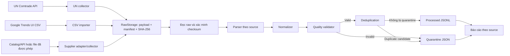

# TÀI LIỆU THU THẬP VÀ XỬ LÝ DỮ LIỆU

- **Đề tài:** Xây dựng hệ thống Business Intelligence phân tích thị hiếu tiêu dùng quốc tế và hỗ trợ ra quyết định đặt hàng xuất khẩu gốm sứ Việt Nam
- **Học phần:** Hệ thống Kinh doanh Thông minh (HTKDTM)
- **Nhóm thực hiện:** Nhóm 06 – Lớp 65HTTT
- **Phạm vi:** Data Collection & ETL

---

## 1. TỔNG QUAN VÀ PHẠM VI THU THẬP DỮ LIỆU

### 1.1. Mục đích

Tài liệu mô tả nguồn và trường dữ liệu, cách thu thập, các bước Extract – Transform – Load (ETL), quy tắc chất lượng, cơ chế deduplication/quarantine và kết quả kiểm tra các tập dữ liệu hiện có. Nội dung phân biệt dữ liệu thực tế với schema được hỗ trợ bởi code hoặc fixture.

Tên trường sau chuẩn hóa trong tài liệu là trường của các cấu trúc ETL trung gian (`Parsed*Record`/`Normalized*Record`), không mặc nhiên là tên cột database.

### 1.2. Phạm vi

Phạm vi gồm UN Comtrade, Google Trends, catalog nhà cung cấp trong nước, adapter/parser cho ITC Trade Map và marketplace/review. Tài liệu chỉ khẳng định đã thu thập dữ liệu thực tế khi có raw collection hoặc tệp incoming được kiểm tra. Không mô tả dashboard, mô hình AI/NLP hoặc đặt hàng như chức năng đã triển khai.

Pipeline hiện xử lý raw của UN Comtrade, Google Trends và catalog trong nước. Pipeline không gọi collector, không truy cập Internet và không nạp PostgreSQL. Không thay đổi raw, database schema, ERD hoặc DDL trong quá trình rà soát và viết tài liệu này.

Việc có collector, parser hoặc fixture không đồng nghĩa nguồn đã được thu thập thực tế; tài liệu không tuyên bố FR-1.1 đến FR-1.5 hoàn thành nếu chưa có dữ liệu và bằng chứng tương ứng.

### 1.3. Quy ước đọc từ điển dữ liệu

- **Quan sát trong raw:** tên và kiểu trường thấy trực tiếp trong payload/CSV hiện có.
- **Đầu vào theo code:** tên trường mà parser/adapter hiện hỗ trợ; nếu nguồn chưa có raw thì đây không phải bằng chứng về phản hồi API thực tế.
- **ETL tạo/ánh xạ:** tên trường hoặc giá trị do importer, collector, parser hay normalizer tạo ra.
- `Bắt buộc` phân biệt yêu cầu parser với yêu cầu validator. Một trường có thể optional ở parser nhưng required khi validation.
- `NormalizedField[T]` là cấu trúc ETL giữ `raw`, `value`, `status`, `note`; `T` là kiểu của `value`.

## 2. DANH SÁCH VÀ MÔ TẢ CÁC NGUỒN DỮ LIỆU

| Nguồn | Phương thức/địa chỉ được ghi nhận | Trạng thái raw và code | Giới hạn hoặc điểm cần lưu ý |
|---|---|---|---|
| UN Comtrade | Preview API tại `https://comtradeapi.un.org`; collector lưu response JSON | 18 raw collections; 574 record parse và valid; registry `ACTIVE` | Preview giới hạn tối đa 500 record mỗi response; collector đánh dấu partial khi response có thể bị cắt |
| Google Trends | Tải CSV thủ công từ `https://trends.google.com/trends/explore`, sau đó dùng CSV importer | 132 CSV, 132 raw collections; registry `ACTIVE`, loại nguồn `MANUAL` | Không scraping. G1 hiện có sáu thị trường: VN, US, JP, DE, FR, IN |
| Minh Long 1 | Manifest lưu `source_url=https://minhlong.com/collections/all/products.json`, `pages_fetched=9` | 1 raw collection, 450 product record; registry hiện khai báo `FILE_DATASET`, không có `base_url` | Registry không khớp phương thức URL trong manifest; raw payload lưu theo schema catalog ETL, không đủ căn cứ xác định toàn bộ tên trường JSON nguyên thủy của website |
| Thế Giới Gốm | Manifest lưu endpoint `/wp-json/wc/store/products` và `source_url=https://thegioigom.com/wp-json/wc/store/products` | 1 raw collection, 500 product record; registry `ACTIVE`, loại `API` | Payload lưu có cấu trúc catalog ETL `supplier/products`; không coi tên trường cấu trúc này là tên trường nguyên thủy của API nếu không có bằng chứng |
| Bát Tràng | Collector `BatTrangWooCommerceCollector` đọc WooCommerce Store API tại `https://gombattrang.vn/wp-json/wc/store/products`; các collection mới lưu response body gốc theo từng trang trước mapping | Hiện có 1 raw collection cũ với 304 product record đã ánh xạ; manifest ghi `public_wc_store_api`, 4 trang thành công | Raw collection hiện có không bị ghi lại và chưa chứa response API nguyên gốc. Registry hiện khai báo `FILE_DATASET` và không có `base_url`, không khớp collector/manifest. Cả 304 record hiện có thiếu `price_vnd` |
| ITC Trade Map | File export; có file adapter và CSV parser | Registry `PLANNED`; chưa có raw export | Tên cột dưới đây là các header parser nhận diện, không phải header đã quan sát từ tệp dự án |
| Etsy | Listing response adapter/parser; review collector yêu cầu API key | Registry `PLANNED`; chưa có raw collection | Có code/fixture; chưa xác minh quyền API hoặc thu thập thực tế |
| Amazon | Creators API response adapter/parser | Registry `PLANNED`; chưa có raw collection | Có parser/adapter và fixture; trong ETL hiện tại chưa xác minh network collector hoạt động |
| Gốc Gốm Việt | Registry/source code path; có thể dùng schema catalog chung nếu có raw phù hợp | Registry `PLANNED`; chưa có raw collection | Chưa xác minh collector hoặc dữ liệu thực tế |

Tình trạng nguồn dựa trên `source_registry.py`, manifest/payload hiện có và đường xử lý trong code. Các khác biệt giữa registry với manifest/collector của Minh Long 1 và Bát Tràng được giữ rõ để nhóm xác nhận, không tự suy diễn trạng thái thay thế.

## 3. TỪ ĐIỂN DỮ LIỆU THEO NGUỒN

### 3.1. UN Comtrade

Raw UN Comtrade là JSON response được lưu nguyên byte. Mỗi record có `raw_record` để giữ các thuộc tính khác ngoài những trường mà parser chuyển thành cấu trúc ETL.

| Tên trường gốc | Tên sau parse/chuẩn hóa | Ý nghĩa | Kiểu dữ liệu | Mức độ bắt buộc | Quy tắc xử lý |
|---|---|---|---|---|---|
| `count` (envelope) | `reported_count` | Số record do API báo cáo | Integer không âm | Bắt buộc ở parser | Kiểm tra kiểu và miền; giữ riêng với số phần tử thực tế trong `data` |
| `data` (envelope) | `records` | Danh sách record thương mại | Mảng object | Bắt buộc ở parser | Mỗi phần tử được parse; payload gốc vẫn được lưu trong raw |
| `reporterCode` | `reporter_code` → `reporter_country` | Mã nước báo cáo | Raw quan sát là integer; parser chuyển thành string; normalized value là string | Required khi validation; có thể thay bằng `reporterDesc` nếu code thiếu | Chuẩn hóa theo danh mục quốc gia; giá trị chưa được xác nhận được đánh dấu chờ xác nhận |
| `reporterDesc` | `reporter_name` → `reporter_country` khi không có code | Tên nước báo cáo | String hoặc null | Thay thế tùy chọn cho mã nước | Parser giữ tên; normalizer dùng làm đầu vào country nếu thiếu code |
| `partnerCode` | `partner_code` → `partner_country` | Mã nước đối tác | Raw quan sát là integer; parser chuyển thành string | Required khi validation; có thể thay bằng `partnerDesc` | Chuẩn hóa theo danh mục quốc gia |
| `partnerDesc` | `partner_name` → `partner_country` khi không có code | Tên nước đối tác | String hoặc null | Thay thế tùy chọn cho mã nước | Giữ tên nguồn; không suy luận đối tác nếu cả code và tên đều thiếu |
| `cmdCode` | `hs_code` | Mã hàng HS | String hoặc integer ở raw; string ở parsed | Bắt buộc ở parser và validator | Chuẩn hóa mã; mã chưa được xác nhận theo danh mục gốm sứ được đánh dấu chờ xác nhận |
| `period` | `period` | Kỳ/năm thống kê | String | Required khi validation | Chuẩn hóa định dạng ngày/kỳ; validator kiểm tra năm trong khoảng 2000–2100 |
| `flowCode` | `flow_code` | Luồng thương mại | String | Required khi validation | `M`/`IMPORT` → `Import`; `X`/`EXPORT` → `Export`; giá trị khác chờ xác nhận |
| `primaryValue` | `trade_value_usd` | Giá trị thương mại chính trong response | Number hoặc null; parsed thành float | Required khi validation; không âm | Parse số và kiểm tra không âm; giữ raw trong `raw_record` |
| `netWgt` | `net_weight_kg` | Khối lượng tịnh | Number hoặc null; parsed thành float | Tùy chọn; nếu có thì không âm | Không tự thay thiếu bằng 0 |
| `cmdDesc` | `product_description` | Mô tả mặt hàng | String hoặc null | Tùy chọn | Chuẩn hóa văn bản; giữ nguyên trường gốc trong `raw_record` |
| `fobvalue`, `cifvalue` | Không có field chuẩn hóa trong `ParsedTradeRecord` | Trị giá FOB/CIF có trong response | Number hoặc null | Tùy chọn | Có mặt trong raw hiện tại nhưng parser chưa đưa vào normalized record |
| `qty`, `qtyUnitAbbr` | Không có field chuẩn hóa hiện tại | Số lượng và đơn vị | Number/string hoặc null | Tùy chọn | Được giữ trong raw JSON; chưa được chuyển thành trường ETL |
| `reporterISO`, `partnerISO` và các trường response còn lại | Không có field chuẩn hóa riêng | ISO, cờ ước lượng, thông tin phân loại/vận tải và thuộc tính API khác | Theo JSON response | Tùy chọn | Được bảo toàn trong payload/raw record; chưa được ánh xạ thành trường ETL riêng |

Các tên như `reporterCode`, `period`, `cmdCode`, `netWgt`, `fobvalue`, `cifvalue` đã được quan sát trong payload thực tế. Parser hiện chỉ trích xuất một phần; không nên hiểu việc trường tồn tại trong raw là đã được chuẩn hóa hoặc sẵn sàng nạp database.

### 3.2. ITC Trade Map

Chưa có file ITC trong raw. Bảng dưới đây chỉ mô tả header candidates được `ITCTradeMapParser` nhận diện.

| Tên trường gốc theo code | Tên sau parse/chuẩn hóa | Ý nghĩa | Kiểu dữ liệu | Mức độ bắt buộc | Quy tắc xử lý |
|---|---|---|---|---|---|
| `Commodity code`, `HS code`, `Product code` | `hs_code` | Mã mặt hàng | CSV string | Parser tìm header phù hợp; giá trị từng dòng có thể rỗng | Trim chuỗi; trường rỗng thành missing; header không phải bằng chứng đã có trong file thật |
| `Period`, `Year` | `period` | Kỳ báo cáo | CSV string | Không bắt buộc ở parser; bắt buộc khi validate trade record | Trim; normalizer/validator xử lý ngày hoặc năm |
| `Trade Value (USD)`, `Value (USD thousands)`, `Value` | `trade_value_usd` | Giá trị thương mại theo cách ghi của file | CSV string, parse thành float | Header/giá trị không bắt buộc ở parser; validator yêu cầu giá trị | Bỏ dấu phẩy rồi parse; code hiện chưa quy đổi đơn vị cho header `Value (USD thousands)`, cần xác nhận trước khi dùng giá trị đó như USD |
| `Reporter`, `Exporter`, `Importer` | `reporter_name` | Tên bên báo cáo/xuất/nhập | CSV string | Tùy chọn theo parser | Lấy cột đầu tiên có trong danh sách; không tự xác định country code |
| Các header còn lại | `raw_record` | Trường khác của file export | CSV string | Tùy chọn | Giữ nguyên trong row; chưa có mapping cụ thể nếu chưa xác nhận schema file thực tế |

### 3.3. Google Trends

Các field bên dưới được quan sát trong 132 CSV thực tế. CSV lưu giá trị dưới dạng text; kiểu số ở cột “sau chuẩn hóa” chỉ có khi chuyển đổi thành công.

| Tên trường gốc | Tên sau parse/chuẩn hóa | Ý nghĩa | Kiểu dữ liệu | Mức độ bắt buộc | Quy tắc xử lý |
|---|---|---|---|---|---|
| `Time` (đang có); parser cũng nhận `Week`, `Day`, `Month` | `period_label`, `period_kind=date` | Thời điểm của Interest Over Time | CSV string → `NormalizedField[str]` | Bắt buộc; importer yêu cầu header thời gian hợp lệ | Chuẩn hóa ngày/kỳ; cadence được suy ra từ dữ liệu thực tế, không cố định monthly hoặc weekly |
| `Region` | `period_label`, `period_kind=region` | Tên khu vực của Interest by Region | CSV string → `NormalizedField[str]` | Bắt buộc | Giữ như nhãn địa lý; không parse thành ngày |
| `ceramic`, `ceramics`, `pottery`, `porcelain`, `stoneware` | `keyword_scores[keyword]` | Giá trị riêng cho từng keyword | CSV string → `NormalizedField[float]` nếu parse được | Importer yêu cầu đúng đủ 5 cột và đúng thứ tự ở Compare; validator yêu cầu từng giá trị | Giữ từng cột riêng; số `0` được giữ; Interest Over Time/Region kiểm tra miền 0–100 |
| `query` hoặc `topic` | `period_label`; `raw_row.query`/`raw_row.topic` | Related query hoặc topic | CSV string → `NormalizedField[str]` | Bắt buộc, không rỗng | Không chuyển thành ngày; giữ loại Queries/Topics theo chart |
| `search interest` | `keyword_scores["search interest"]` | Giá trị quan tâm của related item | CSV string → thử chuẩn hóa số | Phải có giá trị text theo validator Related | Giữ raw string; không suy diễn thành thang điểm nếu format không parse được |
| `increase percent` | `keyword_scores["increase percent"]` | Mức tăng trưởng trong Related | CSV string → thử chuẩn hóa số | Phải có giá trị text theo validator Related | Giữ nguyên phần trăm và `Breakout` trong `raw_row`; dấu `%`/`Breakout` không trở thành số nếu normalizer không parse được |
| `Top`/`Rising` trong nội dung Related | `related_section` | Phân loại Related | CSV text → string `top`/`rising` | Bắt buộc với Related | Lấy từ nội dung CSV và metadata filename/import; validator chỉ nhận `top` hoặc `rising` |
| Không phải cột CSV: từ khóa gốc trong filename/manifest | `source_keyword` | Keyword được thu thập riêng cho Related | ETL metadata string | Bắt buộc với Related | Đối chiếu với filename/header; không lấy tên query làm keyword gốc |
| Không phải cột CSV: chart title | `data_type_hint` | Interest Over Time/Region hoặc Related Queries/Topics | ETL metadata string | Bắt buộc để phân loại Related; Compare được kiểm tra với filename/chart | Dùng để định loại dữ liệu, không thay thế giá trị trong row |
| Không phải cột CSV: `group_id`, `geo`, `keywords`, `period_start`, `period_end`, `data_type`, `related_section`, `original_filename`, `collected_at`, `data_format`, SHA-256 | `manifest.metadata` / `request_parameters` | Provenance và cấu hình thu thập | String/date/list/object theo field | Metadata cần để nhận diện collection; một số field tùy loại export | Tạo bởi importer/adapter; không phải cột dữ liệu nguồn |

G1 hiện dùng năm keyword trên, geo VN/US/JP/DE/FR/IN, khoảng “Past 5 years”, All categories và Web Search. Related CSV hiện dùng header `query`/`topic`, `search interest`, `increase percent`; `Value` là header parser hỗ trợ cho biến thể/test, không phải header quan sát trong các tệp hiện tại.

### 3.4. Catalog nhà cung cấp trong nước

Raw hiện có lưu envelope `supplier` và `products` theo schema catalog ETL. Đây là tên trường quan sát trong payload đã lưu, không khẳng định là tên trường nguyên thủy của website. Riêng Bát Tràng, collector chuyển object WooCommerce thành envelope này trước khi lưu; response WooCommerce nguyên thủy không được giữ nguyên trong `payload.bin`.

#### Trường thông tin nhà cung cấp

| Tên trường trong raw `supplier` | Tên sau parse/chuẩn hóa | Ý nghĩa | Kiểu dữ liệu | Mức độ bắt buộc | Quy tắc xử lý |
|---|---|---|---|---|---|
| `supplier_name` | `ParsedSupplierInfo.supplier_name` | Tên nhà cung cấp | String | Block `supplier` tùy chọn; nếu có block thì tên bắt buộc | Trim; parser từ chối null/rỗng |
| `tax_code` | `ParsedSupplierInfo.tax_code` | Mã số thuế | String/null | Tùy chọn | Kiểm tra mẫu 10–14 chữ số/dấu gạch nối nếu có |
| `address`, `province`, `website`, `phone`, `business_type`, `declared_capacity_note` | Các trường cùng tên trong `ParsedSupplierInfo` | Thông tin liên hệ, loại hình, năng lực do nguồn khai báo | String/null | Tùy chọn | Không suy luận giá trị thiếu |
| `supplier` (envelope) | `ParsedDomesticPayload.supplier` | Thông tin pháp nhân/nhà cung cấp | Object/null | Tùy chọn | Parser có tạo `ParsedSupplierInfo`; pipeline hiện chỉ đưa product records vào processed, không lưu supplier block thành record riêng |

#### Trường sản phẩm và thương mại trong payload catalog đã lưu

| Tên trường trong raw `products[]` | Tên sau parse/chuẩn hóa | Ý nghĩa | Kiểu dữ liệu quan sát/ETL | Mức độ bắt buộc | Quy tắc xử lý |
|---|---|---|---|---|---|
| `source_product_id` | `source_product_id` | Định danh sản phẩm từ payload catalog | String → `NormalizedField[str]` | Bắt buộc ở parser | Trim; riêng Bát Tràng có thể được collector tạo từ SKU hoặc WooCommerce ID |
| `name` | `product_name` | Tên sản phẩm | String/null → `NormalizedField[str]` | Optional ở parser; required ở validator | Chuẩn hóa text; null/rỗng không qua validation |
| `category` | `category` | Danh mục sản phẩm | String/null → `NormalizedField[str]` | Optional ở parser; required ở validator | Chuẩn hóa category; giá trị chưa được xác nhận cần rà soát |
| `description` | Không có field riêng trong normalized domestic DTO; còn trong `raw_record` | Mô tả sản phẩm | String/null | Tùy chọn | Parser giữ trong record đã parse; pipeline bảo toàn qua `raw_record` |
| `product_url` | Không có field riêng trong normalized domestic DTO; còn trong `raw_record` | URL sản phẩm | String/null | Tùy chọn | Không xóa khỏi dữ liệu raw; chưa thành thuộc tính chuẩn hóa riêng |
| `material` | `material` | Chất liệu | String/null → `NormalizedField[str]` | Tùy chọn | Chuẩn hóa text; không suy luận nếu thiếu |
| `origin_region` | `origin_region` | Vùng xuất xứ | String/null → `NormalizedField[str]` | Tùy chọn | Giữ nguồn; không tự gán vùng |
| `price_vnd` | `commercial.price_vnd_str` → `price_vnd` | Giá niêm yết VND | Raw number/null → parsed string → `NormalizedField[Decimal]` | Optional ở parser; required ở validator | Chỉ nhận số hữu hạn, không âm; thiếu không được tự điền |
| `currency` | `commercial.currency` | Mã tiền của giá | String/null; parsed field; không có field riêng trong normalized domestic DTO | Tùy chọn khi giá có giá trị | Nếu có giá nhưng currency vắng/null, parser mặc định `VND`; đây là mặc định ETL, không phải giá trị quan sát được từ nguồn |
| `moq` | `commercial.moq` → `moq` | Số lượng tối thiểu | Integer/null → `NormalizedField[int]` | Tùy chọn; nếu có phải dương | Parser và validator kiểm tra `> 0` |
| `lead_time_days` | `commercial.lead_time_days` → `lead_time_days` | Thời gian giao hàng | Integer/null → `NormalizedField[int]` | Tùy chọn | Parser chấp nhận không âm nhưng validator yêu cầu `> 0` nếu đã có; cần thống nhất quy tắc |
| `wholesale_available` | `commercial.wholesale_available` → `wholesale_available` | Có bán sỉ hay không | Boolean/null → `NormalizedField[bool]` | Tùy chọn | Kiểm tra kiểu boolean; không suy luận từ mô tả |
| `products` (envelope) | `ParsedDomesticPayload.products` | Danh sách sản phẩm | Mảng object | Parser xem absent/null là danh sách rỗng; nếu có phải là array | Mỗi sản phẩm được parse riêng; `record_count` là số phần tử sản phẩm |

#### Trường Bát Tràng ánh xạ từ WooCommerce Store API

Tên bên trái là key/path mà `BatTrangWooCommerceCollector` đọc trong response theo code. Collection Bát Tràng hiện có được thu thập trước khi bật lưu response gốc nên không thể dùng nó để xác minh lại các giá trị API upstream. Với lần thu thập mới, body phản hồi từng trang được giữ nguyên dưới dạng Base64 trong raw envelope trước khi mapping; envelope D9 chỉ được tạo trong bộ nhớ để parser xử lý. Pipeline nhận diện cả envelope mới và payload D9 cũ để replay.

| Trường API được code đọc | Trường trong payload đã lưu | Ý nghĩa | Kiểu theo code | Mức độ bắt buộc | Quy tắc xử lý |
|---|---|---|---|---|---|
| `id` | `wc_id`; có thể tạo `source_product_id` | WooCommerce product ID | Giá trị API, thường là integer | Cần để mapping item vào catalog ETL | Nếu thiếu thì không tạo record parsed/processed; response gốc vẫn được giữ trong raw |
| `sku` | `sku`; ưu tiên tạo `source_product_id` | SKU | String/null | Tùy chọn | SKU rỗng/null thì tạo ID `GBT-<id>`; response gốc giữ nguyên giá trị được API trả về |
| `name` | `name` | Tên sản phẩm | String/null | Tùy chọn trong mapper; required ở validator sau parse | Trim nếu có |
| `permalink` | `product_url` | URL sản phẩm | String/null | Tùy chọn | Trim; được giữ trong raw D9, không có thuộc tính riêng trong normalized domestic record |
| `description`, `short_description` | `description` | Mô tả sản phẩm | HTML string/null | Tùy chọn | Bỏ HTML và gộp khoảng trắng; ưu tiên `description`, fallback `short_description` |
| `prices.price`, `prices.currency_minor_unit` | `store_api_prices`; `price_vnd` | Giá API và số chữ số thập phân | Giá dạng chuỗi số nguyên hoặc integer; minor unit là integer không âm | Tùy chọn ở mapper; giá required ở validator | Lưu lại object `prices`; chỉ tính `price_vnd` khi `price` là chuỗi chữ số, currency là VND và minor unit hiện diện. Giá 0 hợp lệ; không suy giá từ `price_html` |
| `prices.currency_code` | `store_api_prices.currency_code`; `currency` | Mã tiền WooCommerce | String/null | Dùng để xác định có thể ánh xạ `price_vnd` hay không | Chuẩn hóa uppercase; thiếu hoặc khác VND thì `price_vnd` là null, không mặc định currency |
| `price_html` | `price_html` | Chuỗi hiển thị giá | String/null | Tùy chọn | Giữ như chuỗi; không parse làm `price_vnd` |
| `categories[0].name` | `category` | Danh mục đầu tiên | String/null | Tùy chọn ở mapper; required ở validator | Chỉ lấy category đầu tiên |
| `images[0].src` | `image_url` | URL ảnh đầu tiên | String/null | Tùy chọn | Lưu trong raw D9; chưa có field riêng trong normalized domestic DTO |
| `attributes[].name`, `attributes[].terms[].name` | `material`, `dimensions`, `color`, `pattern` | Chất liệu, kích thước, màu, họa tiết | String/null | Tùy chọn | Chọn theo tên attribute; chỉ lấy tên term |
| Không lấy từ API | `origin_region`, `moq`, `lead_time_days`, `wholesale_available` | Thông tin xuất xứ và thương mại | Null do mapper gán | Không có dữ liệu nguồn | Không tạo giá trị thay thế |

### 3.5. Etsy và Amazon – sản phẩm marketplace

Không có raw thực tế cho hai nguồn. Các field dưới đây mô tả schema mà parser/adapter code và fixtures xử lý, không khẳng định là field đã quan sát trong một response thu thập thật.

| Nguồn và trường đầu vào theo code | Tên sau parse/chuẩn hóa | Ý nghĩa | Kiểu dữ liệu | Mức độ bắt buộc | Quy tắc xử lý |
|---|---|---|---|---|---|
| Etsy: `count`, `results[]` | `reported_count`, `records` | Số lượng báo cáo và listing | Integer, array | Bắt buộc ở parser | `count` không âm và không nhỏ hơn số result |
| Etsy: `results[].listing_id` | `source_product_id` | Listing ID | Positive integer → string | Bắt buộc ở parser | Không tạo database ID |
| Etsy: `title`, `url` | `product_name`, `product_url` | Tên và URL listing | String/null | Tùy chọn ở parser; tên required khi quality validation | Chuẩn hóa text; URL giữ giá trị nguồn |
| Etsy: `taxonomy_id` | `category_id` | Mã taxonomy | Positive integer/null → string | Tùy chọn | Parsed, nhưng không có field riêng trong normalized product DTO |
| Etsy: `price.amount`, `price.divisor`, `price.currency_code` | `prices[]` → `price` | Số tiền và mã tiền | Integer, integer dương, string → Decimal/NormalizedCurrency | Có thể thiếu ở parser; giá required khi validation | Amount được chia divisor; không quy đổi tiền tệ nếu thiếu tỷ giá/thời điểm đáng tin cậy |
| Amazon: `itemsResult.items[]` | `records` | Danh sách item | Object array | `itemsResult` và `items` bắt buộc ở parser | Parser đọc cấu trúc response Creators API |
| Amazon: `items[].asin` | `source_product_id` | Mã ASIN | String không rỗng | Bắt buộc ở parser | Giữ như source ID |
| Amazon: `detailPageURL` | `product_url` | URL chi tiết | String/null | Tùy chọn | Giữ URL nếu có |
| Amazon: `itemInfo.title.displayValue` | `product_name` | Tên hiển thị | String/null | Optional ở parser; required khi quality validation | Không tự tạo tên nếu thiếu |
| Amazon: `browseNodeInfo.browseNodes[].displayName/id` hoặc `itemInfo.classifications.productGroup.displayValue` | `category`/`category_id` | Danh mục và mã danh mục | String, ID string/integer | Tùy chọn; thiếu category hiện là warning ở validator | Chỉ đọc các nhánh parser hỗ trợ; không suy đoán taxonomy |
| Amazon: `offersV2.listings[].price.money.amount/currency` | `prices[]` → `price` | Giá offer và mã tiền | Number/Decimal, string | Tùy chọn trong parser; giá required ở validator | Kiểm tra finite, không âm; không quy đổi khi thiếu tỷ giá có thời điểm |

Sau normalize, cấu trúc sản phẩm có `source_product_id`, `product_name`, `product_url`, `category` và `price` (`NormalizedCurrency`). Giá/category ID hoặc thuộc tính khác có thể vẫn nằm trong `raw_record` nhưng không có field riêng trong normalized DTO.

### 3.6. Etsy – review

Không có raw review thực tế. `EtsyReviewParser` và `EtsyReviewCollector` có code; collector cần API key, source được bật và quyền/điều kiện lưu trữ được xác nhận.

| Tên trường đầu vào theo parser | Tên sau parse/chuẩn hóa | Ý nghĩa | Kiểu dữ liệu | Mức độ bắt buộc | Quy tắc xử lý |
|---|---|---|---|---|---|
| `count`, `results[]` | `reported_count`, `records` | Số lượng và danh sách review trong response | Integer, array | Bắt buộc ở parser | Count không âm và không nhỏ hơn số result |
| `results[].listing_id` | `product_reference` | Listing được đánh giá | Integer → string | Bắt buộc | Có thể đối chiếu `expected_listing_id`; không tạo review ID |
| `results[].rating` | `rating` | Điểm đánh giá | Integer | Bắt buộc; 1–5 | Parser và validator kiểm tra miền |
| `results[].review` | `review_text` | Nội dung review | String/null | Optional ở parser; empty/null tạo warning ở validator | Giữ nguyên khoảng trắng ở parse; normalize text |
| `created_timestamp` hoặc `create_timestamp` | `reviewed_at_iso` | Thời điểm tạo review | Integer Unix timestamp → ISO-8601 UTC string | Tùy chọn | Chọn key đầu tiên có mặt; timestamp âm/sai kiểu bị từ chối |
| `results[].language` | `language` | Ngôn ngữ review | String/null | Tùy chọn | Giữ chuỗi nguồn |

## 4. QUY TRÌNH ETL TỔNG THỂ

### 4.1. Sơ đồ luồng hiện tại



Sơ đồ thể hiện các module hiện có, không có nghĩa mọi collector đều đang được gọi tự động. `pipeline.py` chỉ đọc raw có sẵn; hiện không có nhánh pipeline cho raw ITC, Etsy/Amazon products hoặc review.

### 4.2. Đầu vào và đầu ra từng công đoạn

| Công đoạn | Đầu vào | Xử lý hiện tại | Đầu ra | Ngoại lệ/kết quả lỗi |
|---|---|---|---|---|
| Extract | API response hoặc file CSV/catalog | Collector, manual importer hoặc file adapter; nguồn hoạt động phụ thuộc registry/quyền truy cập | Payload collection hoặc CSV trong incoming | HTTP/API lỗi, thiếu quyền, file không hợp lệ; không tạo dữ liệu thay thế |
| Raw storage | Bytes payload | Sinh collection ID, manifest, SHA-256; đọc lại kiểm checksum | `data/raw/<source>/<collection_id>/` | Checksum sai hoặc thiếu manifest báo lỗi |
| Parse | Payload raw và metadata | Parser kiểm tra cấu trúc, trích trường theo source | Parsed payload/record có provenance và raw record | Sai cấu trúc/kiểu/header tạo parse error |
| Transform | Parsed records | Normalizer chuẩn hóa trường; validator áp dụng required/range/rule | Normalized record có status; validation result | Invalid được đưa vào quarantine; pipeline giữ snapshot trước nếu source fail |
| Deduplicate | Record qua validation | Tạo confirmed/candidate key trong phạm vi source/collection phù hợp | Unique, potential duplicate hoặc pending key confirmation | Candidate actionable được quarantine; candidate chưa rõ khóa có thể được giữ processed |
| Load | Record đủ điều kiện | Ghi snapshot JSONL nguyên tử theo source | `data/processed/<source>/records.jsonl` | Không ghi database; lỗi lưu snapshot được báo, snapshot trước được giữ |
| Audit/report | Kết quả xử lý | Tổng hợp collection, parsed, valid, invalid, duplicates, processed và errors | JSON report theo source | Một source lỗi không chặn source được chọn khác |

## 5. QUY TẮC CHUẨN HÓA VÀ KIỂM TRA CHẤT LƯỢNG

### 5.1. Chuẩn hóa

| Nhóm | Quy tắc đã có trong code | Lưu ý |
|---|---|---|
| Text | Trim/chuẩn hóa chuỗi theo helper; giữ raw cùng normalized value/status | `raw_record` hoặc `raw_row` vẫn được lưu |
| Ngày/kỳ | Parse định dạng được hỗ trợ; định dạng chưa xác nhận trả trạng thái chờ xác nhận | Trends region/related không được parse như ngày |
| Số | Parse số finite; mặc định không chấp nhận âm; hỗ trợ `Decimal` cho giá | Chuỗi không parse được không được thay bằng 0 |
| Quốc gia | Tra cứu mã/tên theo danh mục; trường chưa xác nhận chờ thành viên phụ trách | Country code từ UN raw không đồng nghĩa đã có country seed trong DB |
| Luồng thương mại | `M`/`IMPORT` thành `Import`, `X`/`EXPORT` thành `Export` | Mã khác chờ xác nhận |
| HS code/category | Chuẩn hóa theo danh mục dự án đã xác nhận | Không tự gán mã HS hoặc category còn thiếu |
| Tiền tệ | Chuẩn hóa số tiền và mã tiền; chỉ quy đổi khi có exchange rate và timestamp đáng tin cậy | Hiện không có tỷ giá để tạo quy đổi ngoại tệ tự động |
| Google Trends values | Keyword/value được giữ theo cặp; normalizer thử đổi số thành float | `0` giữ được; `%` và `Breakout` còn nguyên ở raw, không nhất thiết có numeric `value` |
| Supplier prices | Chuyển `price_vnd` hợp lệ sang `Decimal` | Không tạo giá khi null/không công bố |

### 5.2. Validation theo nguồn

| Nguồn | Trường/quy tắc chính | Kết quả khi không đạt |
|---|---|---|
| UN Comtrade | Reporter, partner, period/year, flow, HS code và trade value bắt buộc; năm 2000–2100; trade value không âm; net weight tùy chọn nhưng không âm | Record lỗi validation được cách ly; raw không thay đổi |
| Google Trends Compare | Period không rỗng; importer yêu cầu đủ năm keyword G1 đúng thứ tự; từng keyword có giá trị; interest score trong 0–100 | Sai filename/header/geo/chart bị reject ở importer; sai row bị validator đánh dấu |
| Google Trends Region | `Region` là label bắt buộc; các keyword values được kiểm tra như interest score | Không ép Region thành ngày |
| Google Trends Related | Label, loại Queries/Topics, section Top/Rising, source keyword và raw value không rỗng | Thiếu context/value bị validation error; values dạng phần trăm/Breakout phải giữ raw, không suy luận |
| Catalog trong nước | `source_product_id` bắt buộc ở parser; `product_name`, category và `price_vnd` bắt buộc ở validator; giá không âm; MOQ > 0 khi có; lead time > 0 nếu có ở validator | Record không đạt đi quarantine; `price_vnd` null không được tự tạo |
| Sản phẩm marketplace | Parser kiểm tra ID/response; quality validator yêu cầu product name và giá không âm; category thiếu hiện được ghi warning | Chưa chạy trên raw thực tế; fixture/test không tính vào thống kê thu thập |
| Review | Product reference và rating 1–5 bắt buộc; ngày sai định dạng là error; review text trống/null tạo warning ở normalized validator | Chưa có raw review thực tế; không sinh review ID |

`quality_validator.py` chứa các validator cho nhiều record type; pipeline hiện chỉ gọi validator cho UN Comtrade, Google Trends và catalog trong nước. Không mô tả sự hiện diện của validator như bằng chứng nguồn đó đã được thu thập.

## 6. PHÁT HIỆN TRÙNG LẶP VÀ XỬ LÝ DỮ LIỆU LỖI

### 6.1. Deduplication

`DeduplicationIndex` phân biệt exact duplicate, potential duplicate và pending key confirmation. Candidate được tạo từ định danh hoặc thuộc tính record; không gộp chỉ vì hai dòng có nội dung giống nhau nếu thời điểm/collection khác nhau.

- Google Trends candidate key có collection, thời điểm, geo/scope, loại dữ liệu, keyword, section, period và values. Khác collection/lần thu thập không mặc nhiên là duplicate.
- Trade records có xét source row và values; cùng khóa nhưng khác giá trị được giữ là candidate để rà soát.
- Product name đơn lẻ chỉ tạo potential duplicate, không đủ để xóa/gộp bản ghi.
- Khóa nghiệp vụ chưa được xác nhận không được xem là khóa database đã chốt.

### 6.2. Quarantine

`QuarantineStore` lưu `source_id`, `raw_collection_id`, thời điểm, URL nếu có, `record_type`, snapshot, reason/error codes, thời điểm cách ly và recovery history. Loại lý do gồm validation error và potential duplicate. Quarantine là file riêng, không sửa hoặc xóa raw.

Pipeline so fingerprint với quarantine hiện có để lần chạy lại không tạo entry trùng cho cùng record. Duplicate candidate chưa đủ căn cứ để loại khỏi dataset được giữ trong processed và đánh dấu pending key confirmation theo logic pipeline; duplicate actionable và record validation-fail được cách ly.

## 7. CẤU TRÚC LƯU TRỮ DỮ LIỆU

```text
data/
├── incoming/google_trends/
│   ├── *.csv
│   └── .imported_sha256_index.json
├── raw/<source>/<collection_id>/
│   ├── payload.bin
│   └── manifest.json
├── processed/<source>/records.jsonl
└── quarantine/<source>/entries/*.json
```

| Vùng | Nội dung và vai trò | Cách bảo toàn/truy nguyên |
|---|---|---|
| Incoming | CSV Google Trends chờ import | Importer kiểm filename, geo, chart/header, keywords, metadata và SHA-256; index hiện có 132 entries |
| Raw | Payload/CSV theo collection | `RawStorage` cấp ID riêng; manifest có source, `collected_at`, format, version/endpoint, request parameters và SHA-256; `read_payload` xác minh checksum |
| Processed | JSONL snapshot theo source | Mỗi record chứa kiểu record, normalized record và raw row/record provenance; thay thế atomic khi source xử lý thành công |
| Quarantine | JSON entry theo source | Lưu snapshot và lý do để rà soát/recovery; không ghi đè hay xóa payload raw |

Với Bát Tràng, `payload.bin` là envelope catalog D9 do collector tạo từ response WooCommerce, không phải byte-identical response API. RawStorage bảo toàn payload đã nhận ở ranh giới RawStorage; không thể khôi phục các trường upstream mà mapper đã bỏ trước khi lưu.

## 8. KẾT QUẢ THỰC NGHIỆM VÀ THỐNG KÊ THEO NGUỒN

### 8.1. Số liệu raw, validation, deduplication và quarantine

Các số liệu raw/valid lấy từ `pipeline_audit.py` chạy read-only; processed và quarantine được đếm trực tiếp từ JSONL/entry files hiện có. `Valid` được tính trước deduplication.

| Nguồn | Raw collections | Parsed/input records | Valid | Duplicate candidates bị quarantine | Invalid bị quarantine | Processed | Quarantine entries hiện có |
|---|---:|---:|---:|---:|---:|---:|---:|
| UN Comtrade | 18 | 574 | 574 | 0 | 0 | 574 | 0 |
| Google Trends | 132 | 4.868 | 4.868 | 4 | 0 | 4.864 | 4 |
| Minh Long 1 | 1 | 450 | 450 | 7 | 0 | 443 | 7 |
| Thế Giới Gốm | 1 | 500 | 500 | 0 | 0 | 500 | 0 |
| Bát Tràng | 1 | 304 | 0 | 0 | 304 | 0 | 304 |
| **Tổng** | **153** | **6.696** | **6.392** | **11** | **304** | **6.381** | **315** |

Chênh lệch valid và processed là 11: **6.392 − 4 Google Trends − 7 Minh Long 1 = 6.381**. Bát Tràng có 304 invalid do `price_vnd` null; các bản ghi này không nằm trong 6.392 valid. Tổng quarantine hiện có **11 duplicate candidates + 304 validation errors = 315 entries**.

Read-only audit hiện tính duplicate candidates cho Google Trends; trường duplicate count của audit không đo duplicate Minh Long 1. Bảy candidate Minh Long 1 được xác nhận từ kết quả pipeline/quarantine và số record processed, không suy ra từ audit field đó.

### 8.2. Chi tiết Google Trends hiện có

| Dữ liệu | Kết quả đã kiểm tra |
|---|---|
| Incoming CSV và SHA index | 132 CSV, 132 SHA index entries |
| G1 | 5 keyword, 6 thị trường; 22 CSV/thị trường |
| Interest Over Time | Header `Time` và đủ 5 keyword; 61 dòng monthly ở từng thị trường hiện có |
| Interest by Region | Header `Region` và đủ 5 keyword; số dòng thay đổi theo thị trường |
| Duplicate candidates | 4 entry: DE 3, VN 1 |

Số dòng Interest by Region quan sát được: DE 16, FR 22, IN 35, JP 47, US 51, VN 63. Giá trị này mô tả các file hiện có, không phải giới hạn cố định của parser.

### 8.3. Kiểm thử và audit

| Hạng mục | Lệnh/kết quả |
|---|---|
| Google Trends tests | `python -m unittest etl.tests.test_google_trends_d6` — **58 PASS** |
| Toàn bộ ETL tests | `python -m unittest discover -s src\etl\tests -t src` — **452 PASS**, 0 FAIL trong lần chạy hiện tại |
| Raw audit | `python -m etl.pipeline_audit --raw data\raw` — UN Comtrade 574 valid; Trends 4.868 valid/4 candidates; Minh Long 450 valid; Thế Giới Gốm 500 valid; Bát Tràng 304 invalid; 0 parser errors |
| Pipeline chạy lại | Snapshot processed đã được chạy lại; SHA-256 không đổi và không phát sinh quarantine entry mới trong lần chạy lại đã kiểm chứng |

Fixtures/mocks được dùng trong test không được tính là dữ liệu thực tế. Trong lần rà soát tài liệu này chỉ chạy audit read-only và đếm file; không gọi collector trực tuyến hay ghi lại processed/quarantine.

## 9. HẠN CHẾ VÀ HƯỚNG HOÀN THIỆN

- **Chưa có dữ liệu thực tế:** ITC Trade Map, Etsy, Amazon, review và Gốc Gốm Việt chưa có raw collection. Code/parser/fixture không chứng minh đã thu thập thật.
- **Registry và provenance chưa thống nhất:** registry đánh dấu Minh Long 1 và Bát Tràng `FILE_DATASET`, trong khi manifest Minh Long ghi source URL và Bát Tràng collector/manifest ghi `public_wc_store_api`. Cần xác nhận cách đăng ký nguồn, trách nhiệm collector và quy trình vận hành.
- **Bảo toàn raw Bát Tràng:** collection hiện có được tạo trước khi lưu response gốc nên chỉ giữ payload D9 đã ánh xạ; collector mới lưu body phản hồi API từng trang nguyên byte trong envelope Base64 trước mapping. Raw cũ không được sửa hoặc ghi đè.
- **Bát Tràng chưa có giá chuẩn:** 304 record có `price_vnd=null`; `price_html` không được parse thành giá. Cần giá được nguồn công bố hoặc giữ nguyên trong quarantine, không ước lượng.
- **Phạm vi pipeline còn giới hạn:** hiện xử lý raw UN Comtrade, Google Trends và catalog trong nước; chưa tích hợp batch ITC, marketplace products hoặc reviews.
- **Chưa nạp database:** `source_to_target_mapping.py` hiện là đặc tả mapping, chưa có connection, transaction hoặc loader. Primary/natural keys, seed, fact grain, dimension keys và upsert cần database owner xác nhận trước khi nạp.
- **Trường chưa được chuẩn hóa:** UN Comtrade raw có `fobvalue`, `cifvalue`, `qty` và đơn vị nhưng `ParsedTradeRecord` hiện chưa expose chúng; supplier URL/description/image và supplier block không thành normalized fields trong pipeline. Cần xác định nhu cầu đích trước khi mở rộng mapping.
- **Quy tắc cần thống nhất:** `lead_time_days` parser chấp nhận 0 nhưng validator yêu cầu giá trị dương; ITC header `Value (USD thousands)` được parse số nhưng chưa scale đơn vị; cần giải quyết trước khi dùng các trường này cho phân tích/tích hợp.
- **Bằng chứng thu thập trực tuyến:** số liệu tài liệu mô tả collection đang lưu và metadata hiện có; không phải kết quả của một lượt thu thập mới trong lần cập nhật này.
