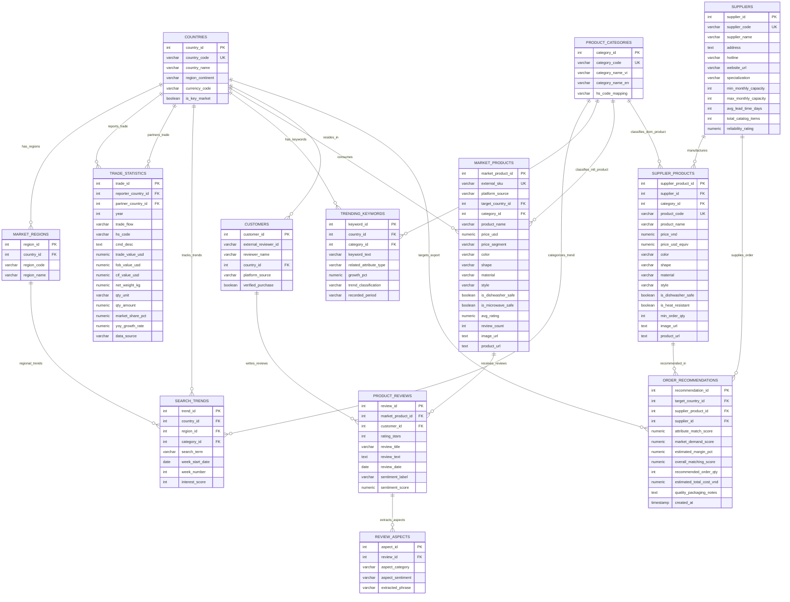
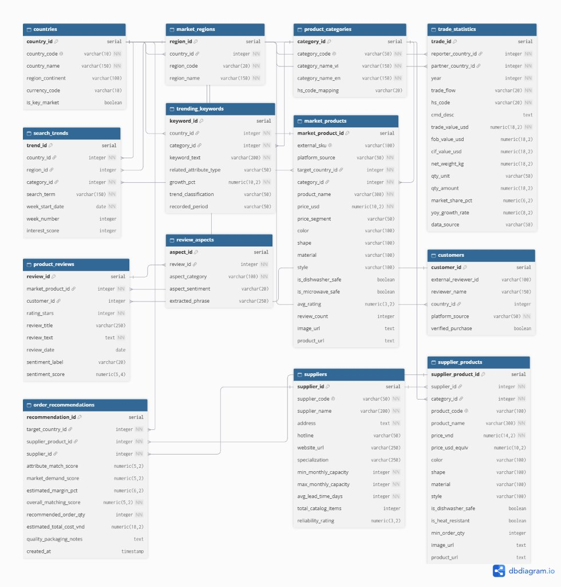

# THIẾT KẾ SƠ ĐỒ THỰC THỂ LIÊN KẾT (ERD) VÀ MÔ HÌNH CƠ SỞ DỮ LIỆU

- **Đề tài:** Xây dựng hệ thống Business Intelligence phân tích thị hiếu tiêu dùng quốc tế và hỗ trợ ra quyết định đặt hàng xuất khẩu gốm sứ Việt Nam
- **Học phần:** Hệ thống Kinh doanh Thông minh (HTKDTM)
- **Nhóm thực hiện:** Nhóm 06 – Lớp 65HTTT
- **Người phụ trách:** Trần Mai Ngọc Anh (Nhóm trưởng – Phân tích nghiệp vụ & Thiết kế CSDL)

---

## 1. Kiến Trúc Mô Hình Cơ Sở Dữ Liệu Quan Hệ (OLTP – ERD)

Mô hình cơ sở dữ liệu quan hệ (Entity-Relationship Diagram - ERD) của hệ thống được thiết kế đạt chuẩn **3NF (Third Normal Form)** trên hệ quản trị cơ sở dữ liệu **PostgreSQL**, nhằm đảm bảo:

1. **Không dư thừa dữ liệu và đảm bảo toàn vẹn tham chiếu:** Mọi bảng dữ liệu giao dịch và phân tích đều tham chiếu thống nhất về hai bảng danh mục lõi là `countries` (Quốc gia/Thị trường) và `product_categories` .
2. **Hỗ trợ đồng thời cho Website tác nghiệp và Kho dữ liệu BI:**
   - Lưu trữ tập trung dữ liệu thu thập từ các nguồn.
   - Lưu trữ kết quả đầu ra của mô hình AI/NLP (`product_reviews`, `review_aspects`) và thuật toán đối chiếu đề xuất đặt hàng (`order_recommendations`).
   - Là nguồn dữ liệu gốc (Source Layer) để nạp sang mô hình **Star Schema (Fact & Dimension)** phục vụ Dashboard BI.

---

## 2. Sơ Đồ Thực Thể Liên Kết Tổng Thể (Mermaid ERD)

---

## 3. Đặc Tả Chi Tiết Mối Quan Hệ Và Bản Số (Relationship & Cardinality Matrix)

Bảng dưới đây tổng hợp toàn bộ **18 liên kết khóa ngoại (Foreign Keys)** giữa 13 bảng thực thể trong sơ đồ ERD:

| STT | Thực thể Cha (1)                    | Thực thể Con (N)        | Khóa kết nối (PK $\rightarrow$ FK)                     | Bản số | Ý nghĩa nghiệp vụ của mối quan hệ                                                                                    |
| :-: | :------------------------------------ | :------------------------ | :---------------------------------------------------------- | :-------: | :-------------------------------------------------------------------------------------------------------------------------- |
|  1  | `countries`                         | `market_regions`        | `country_id` $\rightarrow$ `country_id`               | `1 : N` | Một quốc gia (VD: Hoa Kỳ) gồm nhiều bang hoặc vùng lãnh thổ (51 bang).                                             |
|  2  | `countries`                         | `trade_statistics`      | `country_id` $\rightarrow$ `reporter_country_id`      | `1 : N` | Một quốc gia đóng vai trò quốc gia báo cáo trong nhiều bản ghi thương mại UN Comtrade.                         |
|  3  | `countries`                         | `trade_statistics`      | `country_id` $\rightarrow$ `partner_country_id`       | `1 : N` | Một quốc gia đối tác xuất hiện trong nhiều bản ghi giao thương theo năm và mã HS.                             |
|  4  | `countries`                         | `search_trends`         | `country_id` $\rightarrow$ `country_id`               | `1 : N` | Một quốc gia có chuỗi dữ liệu xu hướng tìm kiếm Google Trends.                                                   |
|  5  | `market_regions`                    | `search_trends`         | `region_id` $\rightarrow$ `region_id`                 | `1 : N` | Một bang/vùng lãnh thổ có nhiều bản ghi chỉ số quan tâm tìm kiếm theo tuần.                                    |
|  6  | `product_categories`                | `search_trends`         | `category_id` $\rightarrow$ `category_id`             | `1 : N` | Một dòng sản phẩm gốm sứ được theo dõi xu hướng tìm kiếm qua nhiều tuần/quốc gia.                          |
|  7  | `countries`                         | `trending_keywords`     | `country_id` $\rightarrow$ `country_id`               | `1 : N` | Một thị trường quốc gia có nhiều từ khóa tìm kiếm thịnh hành/bứt phá.                                        |
|  8  | `product_categories`                | `trending_keywords`     | `category_id` $\rightarrow$ `category_id`             | `1 : N` | Một dòng sản phẩm gắn với nhiều từ khóa bứt phá                                                                  |
|  9  | `countries`                         | `market_products`       | `country_id` $\rightarrow$ `target_country_id`        | `1 : N` | Một thị trường quốc gia tiêu thụ nhiều sản phẩm gốm sứ trên Etsy/Amazon.                                       |
| 10 | `product_categories`                | `market_products`       | `category_id` $\rightarrow$ `category_id`             | `1 : N` | Một dòng sản phẩm chuẩn hóa bao gồm nhiều sản phẩm quốc tế.                                                     |
| 11 | `countries`                         | `customers`             | `country_id` $\rightarrow$ `country_id`               | `1 : N` | Một quốc gia có nhiều khách hàng mua sắm và đánh giá trên sàn TMĐT.                                           |
| 12 | `market_products`                   | `product_reviews`       | `market_product_id` $\rightarrow$ `market_product_id` | `1 : N` | Một sản phẩm quốc tế nhận được nhiều lượt đánh giá (1–5 sao) từ người tiêu dùng.                       |
| 13 | `customers`                         | `product_reviews`       | `customer_id` $\rightarrow$ `customer_id`             | `1 : N` | Một khách hàng có thể viết một hoặc nhiều nhận xét đánh giá sản phẩm.                                       |
| 14 | `product_reviews`                   | `review_aspects`        | `review_id` $\rightarrow$ `review_id`                 | `1 : N` | Một bình luận đánh giá được AI/NLP bóc tách thành nhiều khía cạnh khen/chê (men, bao bì, chịu nhiệt...). |
| 15 | `suppliers`                         | `supplier_products`     | `supplier_id` $\rightarrow$ `supplier_id`             | `1 : N` | Một cơ sở sản xuất nội địa (Minh Long 1, Bát Tràng,...) cung ứng nhiều sản phẩm .                             |
| 16 | `product_categories`                | `supplier_products`     | `category_id` $\rightarrow$ `category_id`             | `1 : N` | Một dòng sản phẩm chuẩn hóa bao gồm nhiều mã sản phẩm gốm sứ nội địa.                                       |
| 17 | `countries`                         | `order_recommendations` | `country_id` $\rightarrow$ `target_country_id`        | `1 : N` | Một thị trường mục tiêu nhận được nhiều phương án đề xuất đặt hàng xuất khẩu.                         |
| 18 | `supplier_products` & `suppliers` | `order_recommendations` | `supplier_product_id` & `supplier_id`                   | `1 : N` | Một sản phẩm nội địa và nhà cung cấp tương ứng được đề xuất cho nhiều thị trường khác nhau.          |

---

## 4. Giải Thích Cơ Chế Kết Nối Dữ Liệu Trên ERD (Cầu Nối Nghiệp Vụ)

Điểm nổi bật nhất trong thiết kế ERD này là giải quyết bài toán **"Làm sao kết nối nhu cầu thị trường quốc tế với nguồn cung nhà sản xuất trong nước?"**:

1. **Cầu nối chuẩn hóa danh mục (`product_categories`):**
   - Cả bảng sản phẩm quốc tế (`market_products`), dữ liệu xu hướng (`search_trends`, `trending_keywords`) và sản phẩm nội địa (`supplier_products`) đều cùng trỏ khóa ngoại `category_id` về bảng `product_categories`.
2. **Cầu nối tương đồng thuộc tính (Attribute Schema Alignment):**
   - Bảng `market_products` (quốc tế) và bảng `supplier_products` (nội địa) được thiết kế đồng cấu trúc (isomorphic) ở 5 trường thuộc tính: `color` (Màu sắc), `shape` (Hình dạng), `material` (Chất liệu), `style` (Phong cách), và `is_dishwasher_safe` / `is_heat_resistant` (Đặc tính kỹ thuật).
   - Nhờ đó, hệ thống có thể dễ dàng thực hiện phép `JOIN` hoặc chấm điểm độ khớp (Cosine Similarity / Weighted Attribute Matching) giữa tập thuộc tính đang bán chạy + được đánh giá cao (`avg_rating >= 4.0`, `sentiment_label = 'Positive'`) tại một quốc gia với 341 sản phẩm của Minh Long 1 và Bát Tràng.
3. **Cầu nối phản hồi khách hàng vào đơn đặt hàng (`review_aspects` $\rightarrow$ `order_recommendations`):**
   - Tỷ lệ phàn nàn theo từng khía cạnh trong bảng `review_aspects` (ví dụ: phàn nàn về `Packaging` - vỡ khi vận chuyển hoặc `Glaze Durability` - trầy men) tại từng thị trường (`target_country_id`) được tổng hợp để tự động sinh cảnh báo kỹ thuật vào trường `quality_packaging_notes` của bảng `order_recommendations`.

---

## 5. Sơ Đồ ERD

