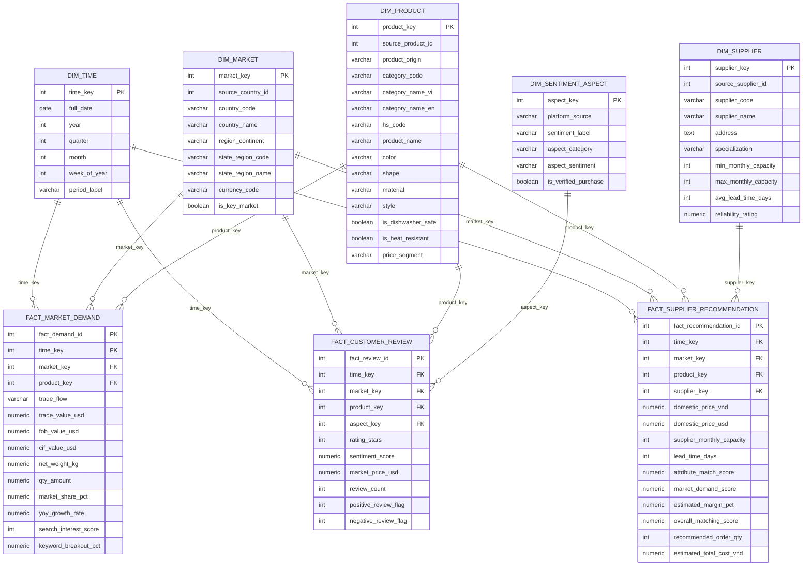
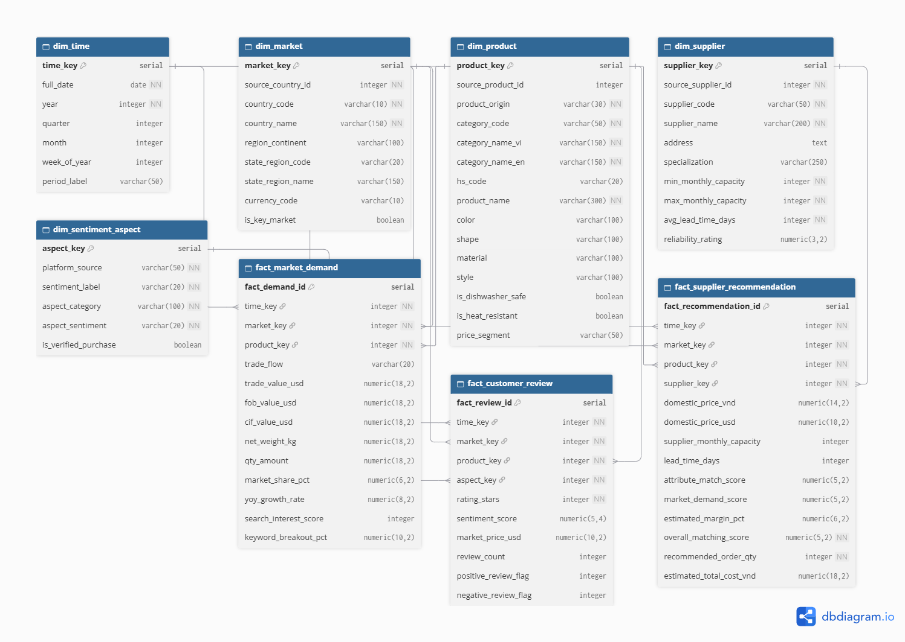

# THIẾT KẾ MÔ HÌNH DỮ LIỆU STAR SCHEMA PHỤC VỤ PHÂN TÍCH BI

- **Đề tài:** Xây dựng hệ thống Business Intelligence phân tích thị hiếu tiêu dùng quốc tế và hỗ trợ ra quyết định đặt hàng xuất khẩu gốm sứ Việt Nam
- **Học phần:** Hệ thống Kinh doanh Thông minh (HTKDTM)
- **Nhóm thực hiện:** Nhóm 06 – Lớp 65HTTT
- **Người phụ trách:** Trần Mai Ngọc Anh (Nhóm trưởng – Phân tích nghiệp vụ & Thiết kế CSDL)

---

## 1. Tổng Quan Kiến Trúc Kho Dữ Liệu (Star Schema – OLAP)

Trong khi mô hình **ERD (13 bảng chuẩn 3NF)** tại tệp [thiet_ke_erd.md](file:///d:/SUBJECTS/HTKDTM/project-htkdtm/nhom06-65httt/docs/thiet_ke_erd.md) được tối ưu cho việc thu thập, làm sạch và quản lý dữ liệu tác nghiệp (OLTP), thì mô hình **Star Schema (Lược đồ Hình sao)** được thiết kế chuyên biệt cho tầng **Kho dữ liệu phân tích (Data Warehouse / OLAP)** nhằm:

1. **Tối ưu hiệu năng truy vấn đa chiều cho 4 Dashboard BI:** Giảm số lượng phép nối (`JOIN`) phức tạp, cho phép người dùng thực hiện các thao tác OLAP (*Slice, Dice, Drill-down, Roll-up*) theo Thời gian, Quốc gia, Dòng sản phẩm, Thuộc tính thị hiếu và Nhà cung cấp với thời gian phản hồi tức thì.
2. **Chuẩn hóa các Chiều phân tích dùng chung (Conformed Dimensions):** Kết nối đồng nhất dữ liệu vĩ mô (UN Comtrade, Google Trends), dữ liệu vi mô (Sản phẩm & Đánh giá Etsy/Amazon) và dữ liệu nguồn cung nội địa (Minh Long 1, Bát Tràng) trên cùng một hệ quy chiếu.
3. **Tập trung hóa các Chỉ số đo lường kinh doanh (Measures / KPIs):** Quản lý rõ ràng các chỉ số cốt lõi theo yêu cầu đề tài: *Giá trị nhập khẩu, Tốc độ tăng trưởng, Mức độ quan tâm, Điểm đánh giá khách hàng, Điểm phù hợp thị hiếu và Số lượng đặt hàng đề xuất*.

---

## 2. Xác Định Các Bảng Chiều (Dimension Tables) Và Bảng Sự Kiện (Fact Tables)

Mô hình kho dữ liệu của hệ thống sử dụng kiến trúc **Star Schema (mở rộng theo chuẩn Kimball Fact Constellation với các Conformed Dimensions)** gồm **5 Bảng Chiều (Dimensions)** dùng chung và **3 Bảng Sự kiện (Facts)** tương ứng với 3 mảng phân tích cốt lõi trên 4 Dashboard BI:

### 2.1. Danh sách 5 Bảng Chiều (Dimension Tables)

|     STT     | Tên bảng Dimension               | Chiều phân tích                          | Nguồn ánh xạ từ ERD (OLTP)                                                     | Vai trò phân tích trên Dashboard BI                                                                                                                                                            |
| :---------: | :--------------------------------- | :------------------------------------------ | :--------------------------------------------------------------------------------- | :------------------------------------------------------------------------------------------------------------------------------------------------------------------------------------------------- |
| **1** | **`dim_time`**             | Chiều Thời gian                           | Trích xuất từ `year`, `week_start_date`, `review_date`, `created_at`    | Phân tích xu hướng theo Năm (2021–2023), Quý, Tháng và Chuỗi 52 tuần (Google Trends).                                                                                                   |
| **2** | **`dim_market`**           | Chiều Quốc gia & Vùng thị trường      | Gộp phẳng (Denormalize) từ `countries` + `market_regions`                   | Phân tích, so sánh và lọc theo >130 Quốc gia (Mỹ, Nhật, Đức, Pháp...), Châu lục và 51 Bang/Vùng lãnh thổ.                                                                         |
| **3** | **`dim_product`**          | Chiều Sản phẩm & Thuộc tính thị hiếu | Kết hợp từ `product_categories` + `market_products` + `supplier_products` | Phân tích theo 4 Dòng sản phẩm chủ lực và 5 thuộc tính: Màu sắc, Hình dạng, Chất liệu, Phong cách, Tính năng chịu nhiệt/máy rửa bát, Phân khúc giá.                     |
| **4** | **`dim_supplier`**         | Chiều Nhà cung cấp nội địa            | Ánh xạ từ bảng `suppliers`                                                   | Phân tích năng lực nguồn cung trong nước (Minh Long 1, Bát Tràng), công suất, thời gian giao hàng và độ uy tín.                                                                   |
| **5** | **`dim_sentiment_aspect`** | Chiều Cảm xúc & Khía cạnh AI/NLP       | Kết hợp từ `customers` + `product_reviews` + `review_aspects`             | Phân tích theo nền tảng TMĐT (Etsy/Amazon), 3 trạng thái cảm xúc (Tích cực/Trung lập/Tiêu cực) và các khía cạnh được khen/chê (độ bền men, đóng gói, chịu nhiệt...). |

### 2.2. Danh sách 3 Bảng Sự kiện (Fact Tables)

|     STT     | Tên bảng Fact                            | Độ mịn dữ liệu (Granularity)                                                                                                                                              | Các khóa ngoại (Dimension Keys)                              | Phục vụ Dashboard BI                                                                                                   |
| :---------: | :----------------------------------------- | :----------------------------------------------------------------------------------------------------------------------------------------------------------------------------- | :-------------------------------------------------------------- | :----------------------------------------------------------------------------------------------------------------------- |
| **1** | **`fact_market_demand`**           | Mỗi bản ghi thể hiện số liệu thương mại & mức độ quan tâm tìm kiếm của 1 thị trường đối với 1 nhóm sản phẩm trong 1 kỳ thời gian                    | `time_key`, `market_key`, `product_key`                   | • **Dashboard 1:** Tổng quan thị trường• **Dashboard 2:** Phân tích thị hiếu & xu hướng          |
| **2** | **`fact_customer_review`**         | Mỗi bản ghi thể hiện kết quả đánh giá và phân tích cảm xúc AI/NLP trên từng khía cạnh của 1 sản phẩm quốc tế tại 1 thị trường                       | `time_key`, `market_key`, `product_key`, `aspect_key`   | • **Dashboard 2:** Phân tích thị hiếu thuộc tính• **Dashboard 3:** Phân tích khách hàng (AI/NLP) |
| **3** | **`fact_supplier_recommendation`** | Mỗi bản ghi thể hiện kết quả đối chiếu cung – cầu và đề xuất đặt hàng cho 1 sản phẩm nội địa của 1 nhà cung cấp ứng với 1 thị trường mục tiêu | `time_key`, `market_key`, `product_key`, `supplier_key` | • **Dashboard 4:** Sản phẩm & Nhà cung cấp• **Màn hình DSS:** Đề xuất đặt hàng xuất khẩu     |

---

## 3. Sơ Đồ Mô Hình Dữ Liệu Star Schema (Mermaid Diagram)

---

## 4. Đặc Tả Chi Tiết Cấu Trúc Các Bảng Dimension Và Bảng Fact

### 4.1. Cấu trúc các Bảng Chiều (Dimension Tables)

#### a. Bảng chiều Thời gian (`dim_time`)

Hỗ trợ phân tích theo nhiều cấp độ thời gian (Roll-up từ Ngày/Tuần lên Tháng, Quý, Năm).

| Tên trường    | Kiểu dữ liệu      | Ràng buộc       | Mô tả ý nghĩa phân tích                                                                  |
| :--------------- | :------------------- | :---------------- | :--------------------------------------------------------------------------------------------- |
| `time_key`     | `SERIAL / INTEGER` | `PRIMARY KEY`   | Khóa đại diện chiều thời gian (Surrogate Key, định dạng `YYYYMMDD` hoặc tự tăng) |
| `full_date`    | `DATE`             | `NOT NULL`      | Ngày đầy đủ (ngày đầu năm cho dữ liệu năm, ngày đầu tuần cho chuỗi 52 tuần)  |
| `year`         | `INTEGER`          | `NOT NULL`      | Năm phân tích (`2021`, `2022`, `2023`,...)                                            |
| `quarter`      | `INTEGER`          | `CHECK (1..4)`  | Quý trong năm (`1`, `2`, `3`, `4`)                                                   |
| `month`        | `INTEGER`          | `CHECK (1..12)` | Tháng trong năm (`1` – `12`)                                                            |
| `week_of_year` | `INTEGER`          | `CHECK (1..53)` | Tuần trong năm (`1` – `52` phục vụ chuỗi thời gian Google Trends)                   |
| `period_label` | `VARCHAR(50)`      | `NULL`          | Nhãn hiển thị trên biểu đồ BI (VD: `'2023-W42'`, `'Q4/2023'`, `'Năm 2023'`)      |

#### b. Bảng chiều Quốc gia & Thị trường (`dim_market`)

Gộp phẳng (Denormalize) hai bảng `countries` và `market_regions` để phục vụ phân tích địa lý từ cấp Châu lục $\rightarrow$ Quốc gia (>130 nước) $\rightarrow$ Bang/Vùng lãnh thổ (51 bang).

| Tên trường         | Kiểu dữ liệu  | Ràng buộc            | Mô tả ý nghĩa phân tích                                                             |
| :-------------------- | :--------------- | :--------------------- | :---------------------------------------------------------------------------------------- |
| `market_key`        | `SERIAL`       | `PRIMARY KEY`        | Khóa đại diện chiều thị trường (Surrogate Key)                                    |
| `source_country_id` | `INTEGER`      | `NOT NULL`           | Mã `country_id` gốc từ hệ thống OLTP                                               |
| `country_code`      | `VARCHAR(10)`  | `NOT NULL`           | Mã quốc gia ISO3 (`'USA'`, `'JPN'`, `'DEU'`, `'FRA'`,...)                       |
| `country_name`      | `VARCHAR(150)` | `NOT NULL`           | Tên quốc gia hiển thị trên Dashboard                                                 |
| `region_continent`  | `VARCHAR(100)` | `NULL`               | Châu lục / Khu vực kinh tế (`'North America'`, `'East Asia'`, `'Europe'`)       |
| `state_region_code` | `VARCHAR(20)`  | `DEFAULT 'ALL'`      | Mã bang/vùng lãnh thổ (`'US-CA'`, `'US-NY'` hoặc `'ALL'` cho cấp toàn quốc) |
| `state_region_name` | `VARCHAR(150)` | `DEFAULT 'National'` | Tên bang/vùng lãnh thổ (51 bang từ Google Trends)                                    |
| `currency_code`     | `VARCHAR(10)`  | `NULL`               | Đơn vị tiền tệ (`'USD'`, `'JPY'`, `'EUR'`)                                     |
| `is_key_market`     | `BOOLEAN`      | `DEFAULT FALSE`      | Cờ lọc nhanh nhóm thị trường mục tiêu trọng điểm                               |

#### c. Bảng chiều Sản phẩm & Thuộc tính (`dim_product`)

Tích hợp danh mục 4 dòng sản phẩm chủ lực cùng bộ 5 thuộc tính thị hiếu của cả sản phẩm quốc tế (Etsy, Amazon) và 341 sản phẩm nội địa (Minh Long 1, Bát Tràng).

| Tên trường          | Kiểu dữ liệu  | Ràng buộc       | Mô tả ý nghĩa phân tích                                                                                              |
| :--------------------- | :--------------- | :---------------- | :------------------------------------------------------------------------------------------------------------------------- |
| `product_key`        | `SERIAL`       | `PRIMARY KEY`   | Khóa đại diện chiều sản phẩm (Surrogate Key)                                                                        |
| `source_product_id`  | `INTEGER`      | `NULL`          | Mã sản phẩm gốc từ `market_products` hoặc `supplier_products`                                                    |
| `product_origin`     | `VARCHAR(30)`  | `NOT NULL`      | Nguồn sản phẩm (`'International'` - Quốc tế, `'Domestic'` - Nội địa, `'Category_Level'` - Cấp nhóm ngành) |
| `category_code`      | `VARCHAR(50)`  | `NOT NULL`      | Mã dòng sản phẩm (`'TEA_SET'`, `'MUG_CUP'`, `'DINNERWARE'`, `'VASE_DECOR'`)                                    |
| `category_name_vi`   | `VARCHAR(150)` | `NOT NULL`      | Tên dòng sản phẩm (`'Bộ ấm chén'`, `'Ly cốc sứ'`, `'Bát đĩa bàn ăn'`, `'Lọ hoa mỹ nghệ'`)         |
| `category_name_en`   | `VARCHAR(150)` | `NOT NULL`      | Tên tiếng Anh tương ứng                                                                                               |
| `hs_code`            | `VARCHAR(20)`  | `NULL`          | Mã HS thương mại quốc tế (`'6911'`, `'6912'`, `'6913'`)                                                        |
| `product_name`       | `VARCHAR(300)` | `NOT NULL`      | Tên chi tiết của sản phẩm                                                                                             |
| `color`              | `VARCHAR(100)` | `NULL`          | **Thuộc tính 1 – Màu sắc:** Trắng, Xanh lam, Nâu, Màu tự nhiên, Đa sắc...                                |
| `shape`              | `VARCHAR(100)` | `NULL`          | **Thuộc tính 2 – Hình dạng:** Tròn, Vuông, Oval, Hình dáng nghệ thuật...                                  |
| `material`           | `VARCHAR(100)` | `NULL`          | **Thuộc tính 3 – Chất liệu:** Sứ (Porcelain), Gốm (Earthenware), Stoneware, Men rạn...                       |
| `style`              | `VARCHAR(100)` | `NULL`          | **Thuộc tính 4 – Phong cách:** Tối giản (Minimalist), Hiện đại, Truyền thống, Thủ công...               |
| `is_dishwasher_safe` | `BOOLEAN`      | `DEFAULT FALSE` | **Thuộc tính 5a – Công năng:** An toàn với máy rửa bát                                                     |
| `is_heat_resistant`  | `BOOLEAN`      | `DEFAULT FALSE` | **Thuộc tính 5b – Công năng:** Chịu nhiệt / An toàn lò vi sóng                                             |
| `price_segment`      | `VARCHAR(50)`  | `NULL`          | Phân khúc giá (`'Budget <$20'`, `'Mid-range $20-$60'`, `'Premium >$60'`)                                          |

#### d. Bảng chiều Nhà cung cấp nội địa (`dim_supplier`)

Lưu trữ các thuộc tính phân tích của cơ sở sản xuất gốm sứ Việt Nam.

| Tên trường            | Kiểu dữ liệu  | Ràng buộc     | Mô tả ý nghĩa phân tích                                                |
| :----------------------- | :--------------- | :-------------- | :--------------------------------------------------------------------------- |
| `supplier_key`         | `SERIAL`       | `PRIMARY KEY` | Khóa đại diện chiều nhà cung cấp (Surrogate Key)                      |
| `source_supplier_id`   | `INTEGER`      | `NOT NULL`    | Mã `supplier_id` gốc từ bảng `suppliers`                             |
| `supplier_code`        | `VARCHAR(50)`  | `NOT NULL`    | Mã nhà cung cấp (`'NCC_MINHLONG1'`, `'NCC_BATTRANG'`)                 |
| `supplier_name`        | `VARCHAR(200)` | `NOT NULL`    | Tên nhà cung cấp (`'Gốm sứ Minh Long 1'`, `'Gốm sứ Bát Tràng'`) |
| `address`              | `TEXT`         | `NULL`        | Khu vực / Địa chỉ nhà máy sản xuất                                   |
| `specialization`       | `VARCHAR(250)` | `NULL`        | Thế mạnh sản xuất chủ lực                                              |
| `min_monthly_capacity` | `INTEGER`      | `NOT NULL`    | Công suất tối thiểu (sản phẩm/tháng)                                  |
| `max_monthly_capacity` | `INTEGER`      | `NOT NULL`    | Công suất tối đa (10.000 đến >500.000 sản phẩm/tháng)               |
| `avg_lead_time_days`   | `INTEGER`      | `NOT NULL`    | Thời gian giao hàng cam kết trung bình (ngày)                           |
| `reliability_rating`   | `NUMERIC(3,2)` | `NULL`        | Điểm đánh giá năng lực & độ tin cậy (1.00 – 5.00)                 |

#### e. Bảng chiều Cảm xúc & Khía cạnh đánh giá (`dim_sentiment_aspect`)

Phục vụ phân tích sâu kết quả mô hình AI/NLP đối với phản hồi của khách hàng quốc tế.

| Tên trường            | Kiểu dữ liệu  | Ràng buộc      | Mô tả ý nghĩa phân tích                                                                                                                              |
| :----------------------- | :--------------- | :--------------- | :--------------------------------------------------------------------------------------------------------------------------------------------------------- |
| `aspect_key`           | `SERIAL`       | `PRIMARY KEY`  | Khóa đại diện chiều cảm xúc & khía cạnh (Surrogate Key)                                                                                           |
| `platform_source`      | `VARCHAR(50)`  | `NOT NULL`     | Nền tảng đánh giá (`'Etsy'`, `'Amazon'`)                                                                                                          |
| `sentiment_label`      | `VARCHAR(20)`  | `NOT NULL`     | Cảm xúc tổng thể của bài đánh giá (`'Positive'`, `'Neutral'`, `'Negative'`)                                                                 |
| `aspect_category`      | `VARCHAR(100)` | `NOT NULL`     | Nhóm đặc điểm sản phẩm được nhắc tới (`'Glaze Durability'`, `'Packaging'`, `'Design & Color'`, `'Heat/Dishwasher'`, `'Price/Value'`) |
| `aspect_sentiment`     | `VARCHAR(20)`  | `NOT NULL`     | Thái độ đối với đặc điểm đó (`'Positive'` - Khen ngợi, `'Negative'` - Phàn nàn, `'Neutral'`)                                          |
| `is_verified_purchase` | `BOOLEAN`      | `DEFAULT TRUE` | Đánh giá từ đơn hàng đã xác thực                                                                                                                |

---

### 4.2. Cấu trúc các Bảng Sự kiện (Fact Tables) và Chỉ số phân tích (Measures)

Bảng dưới đây đặc tả toàn bộ các **Chỉ số định lượng (Measures / KPIs)** nằm trong 3 bảng Fact theo đúng yêu cầu môn học:

| Bảng Fact                                 | Tên cột Chỉ số (Measure)         | Kiểu dữ liệu   |    Hàm tổng hợp BI    | Ý nghĩa phân tích kinh doanh                                                                                                  |
| :----------------------------------------- | :----------------------------------- | :---------------- | :-----------------------: | :-------------------------------------------------------------------------------------------------------------------------------- |
| **`fact_market_demand`**           | `trade_value_usd`                  | `NUMERIC(18,2)` |     `SUM`, `AVG`     | **Giá trị nhập khẩu / Kim ngạch thương mại (USD)** theo quốc gia và năm.                                         |
|                                            | `fob_value_usd`, `cif_value_usd` | `NUMERIC(18,2)` |          `SUM`          | Trị giá thương mại theo điều kiện giao hàng FOB và CIF (USD).                                                           |
|                                            | `net_weight_kg`                    | `NUMERIC(18,2)` |          `SUM`          | Tổng khối lượng tịnh gốm sứ nhập khẩu (kg).                                                                              |
|                                            | `market_share_pct`                 | `NUMERIC(6,2)`  |     `AVG`, `MAX`     | **Thị phần nhập khẩu (%)** của quốc gia trên tổng giao thương toàn cầu.                                         |
|                                            | `yoy_growth_rate`                  | `NUMERIC(8,2)`  |          `AVG`          | **Tốc độ tăng trưởng kim ngạch (%)** qua các năm giai đoạn 2021–2023.                                           |
|                                            | `search_interest_score`            | `INTEGER`       |     `AVG`, `MAX`     | **Mức độ quan tâm tìm kiếm (0–100)** trên Google Trends theo tuần và bang.                                        |
|                                            | `keyword_breakout_pct`             | `NUMERIC(10,2)` |     `MAX`, `AVG`     | **Tốc độ bứt phá từ khóa (%)** đối với các xu hướng gốm sứ mới (+140% đến +5.300%).                       |
| **`fact_customer_review`**         | `rating_stars`                     | `INTEGER`       |    `AVG`, `COUNT`    | **Điểm đánh giá khách hàng (1–5 sao)** cho từng sản phẩm và thuộc tính.                                       |
|                                            | `sentiment_score`                  | `NUMERIC(5,4)`  |          `AVG`          | Điểm độ tin cậy cảm xúc của mô hình AI/NLP (0.0 – 1.0).                                                                |
|                                            | `market_price_usd`                 | `NUMERIC(10,2)` | `AVG`, `MIN`, `MAX` | **Mức giá bán quốc tế (USD)** theo dòng sản phẩm, màu sắc, chất liệu, phong cách.                              |
|                                            | `review_count`                     | `INTEGER`       |    `SUM`, `COUNT`    | Tổng số lượt nhận xét của người tiêu dùng.                                                                             |
|                                            | `positive_review_flag`             | `INTEGER (0/1)` |      `SUM / COUNT`      | Cờ đếm nhanh **Tỷ lệ cảm xúc Tích cực (%)** và tỷ lệ khen ngợi theo khía cạnh.                               |
|                                            | `negative_review_flag`             | `INTEGER (0/1)` |      `SUM / COUNT`      | Cờ đếm nhanh **Tỷ lệ phàn nàn / Tiêu cực (%)** (VD: lỗi bao bì, trầy men).                                      |
| **`fact_supplier_recommendation`** | `domestic_price_vnd`               | `NUMERIC(14,2)` |     `AVG`, `MIN`     | **Giá nhập sản phẩm nội địa (VNĐ)** từ Minh Long 1, Bát Tràng.                                                   |
|                                            | `domestic_price_usd`               | `NUMERIC(10,2)` |     `AVG`, `MIN`     | Giá nhập quy đổi sang USD để đối chiếu trực tiếp với `market_price_usd`.                                            |
|                                            | `supplier_monthly_capacity`        | `INTEGER`       |     `MAX`, `SUM`     | **Năng lực cung ứng (sản phẩm/tháng)** của cơ sở sản xuất.                                                       |
|                                            | `lead_time_days`                   | `INTEGER`       |     `MIN`, `AVG`     | **Thời gian giao hàng cam kết (ngày)**.                                                                                 |
|                                            | `attribute_match_score`            | `NUMERIC(5,2)`  |     `AVG`, `MAX`     | Điểm tương thích về thuộc tính (màu sắc, hình dáng, chất liệu, phong cách) với thị trường mục tiêu (0–100). |
|                                            | `market_demand_score`              | `NUMERIC(5,2)`  |     `AVG`, `MAX`     | Điểm sức cầu thị trường mục tiêu (0–100).                                                                               |
|                                            | `estimated_margin_pct`             | `NUMERIC(6,2)`  |     `AVG`, `MAX`     | Biên lợi nhuận gộp kỳ vọng khi xuất khẩu sang thị trường mục tiêu (%).                                               |
|                                            | `overall_matching_score`           | `NUMERIC(5,2)`  |     `MAX`, `AVG`     | **Điểm đề xuất tổng hợp (0–100)** để xếp hạng ưu tiên đặt hàng.                                            |
|                                            | `recommended_order_qty`            | `INTEGER`       |     `SUM`, `AVG`     | **Số lượng đặt hàng tham khảo (sản phẩm)**.                                                                        |
|                                            | `estimated_total_cost_vnd`         | `NUMERIC(18,2)` |          `SUM`          | Tổng ngân sách thu mua dự kiến cho đơn đặt hàng (VNĐ).                                                                 |

---

## 5. Ma Trận Kimball Bus Matrix & Ánh Xạ Phục Vụ 4 Dashboard BI

Ma trận dưới đây chứng minh mô hình Star Schema đáp ứng trọn vẹn mọi chiều phân tích và chỉ số cho 4 Dashboard BI và Màn hình Đề xuất đặt hàng (của thành viên 4 – Trung):

| Bảng Sự kiện (Fact)                     | `dim_time` (Thời gian) | `dim_market` (Quốc gia/Vùng) | `dim_product` (Sản phẩm & 5 Thuộc tính) | `dim_sentiment_aspect` (Cảm xúc & Khía cạnh AI) | `dim_supplier` (Nhà cung cấp nội địa) | Dashboard BI Sử dụng                                                                                               |
| :----------------------------------------- | :-----------------------: | :------------------------------: | :-------------------------------------------: | :---------------------------------------------------: | :------------------------------------------: | :------------------------------------------------------------------------------------------------------------------- |
| **`fact_market_demand`**           |        **X**        |           **X**           |                  **X**                  |                                                      |                                              | **Dashboard 1:** Tổng quan thị trường**Dashboard 2:** Phân tích thị hiếu (Xu hướng)            |
| **`fact_customer_review`**         |        **X**        |           **X**           |                  **X**                  |                      **X**                      |                                              | **Dashboard 2:** Phân tích thị hiếu (Thuộc tính)**Dashboard 3:** Phân tích khách hàng (AI/NLP) |
| **`fact_supplier_recommendation`** |        **X**        |           **X**           |                  **X**                  |                                                      |                 **X**                 | **Dashboard 4:** Sản phẩm & Nhà cung cấp**Màn hình DSS:** Đề xuất đặt hàng                   |

---

## 6. Mô Hình Star Schema

